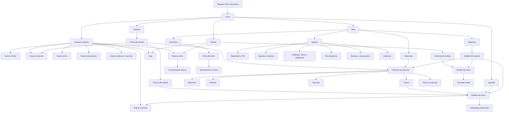
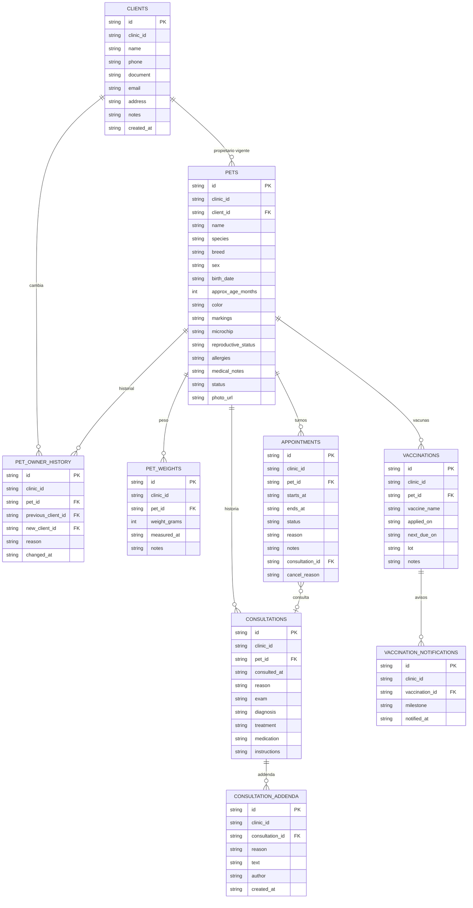
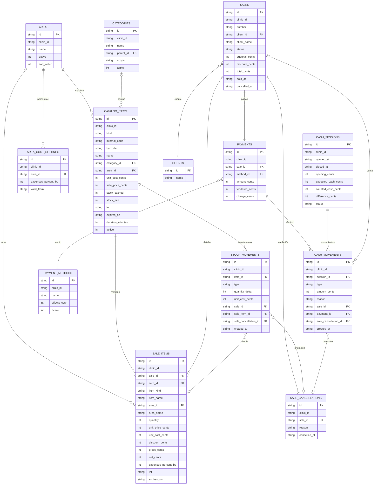

# Planificación: app Android de gestión veterinaria

*Documento de planificación · Parte 1: análisis, decisiones de arquitectura y MVP · Parte 2: especificaciones de las etapas 4 a 7, mapa de navegación y modelo E-R · Revisión de alcance del 24 de octubre de 2026 (sección 9)*

## Resumen ejecutivo

- **Recomendación central:** app nativa en Kotlin con Jetpack Compose y base local Room (SQLite) como fuente de verdad. Arranca en un solo dispositivo, sin servidor y sin costo recurrente, pero se diseña local-first: identificadores, versionado y operaciones quedan preparados para sumar sincronización más adelante sin reescribir.
- **MVP:** clientes, mascotas, historia clínica básica, vacunaciones con recordatorios (prioridad del proyecto), turnos, catálogo con stock, ventas con caja y un dashboard con facturación por área. Incluye backup/restauración y bloqueo de la app.
- **Cambios al plan original:** backup y seguridad base se adelantan (antes de cargar datos reales), turnos pasan antes del catálogo y el dashboard se construye de forma incremental en lugar de al final.
- **Antes de programar** hay que confirmar siete decisiones (sección 1.4) y responder cinco preguntas (sección 1.6).
- Esta Parte 1 cubre análisis, arquitectura y MVP. La Parte 2, iniciada con la etapa 4, desarrolla la especificación funcional por módulo, el mapa de navegación, el diseño UX/UI lila, las reglas de negocio, el modelo de datos, el plan detallado por etapa y los criterios de aceptación.

> **Actualización 23/10/2026 — Plan v2 aprobado.** Reemplaza D1/D2, la recomendación de 2.1, el stack de 2.2 y el alcance de la sección 3 en lo relativo a sincronización. Resumen: una device, una cuenta, Room local-first con sync propio a Supabase Free en São Paulo, subida inmediata sin Realtime, backup local cifrado semanal sin fotos y fotos online-only comprimidas en el bucket público `mascotas`. El detalle está al final del documento.

## 1. Análisis inicial

### 1.1 Objetivo y problema que resuelve

Una veterinaria suele repartir su información entre cuadernos, planillas, mensajes y la memoria del personal: se pierden vacunas por vencer, no se sabe cuánto stock queda, la caja se cuadra a mano y nadie ve con claridad qué área rinde más. El objetivo es centralizar clientes, mascotas, historias clínicas, vacunaciones, turnos, inventario, ventas y resultados en una app Android moderna, confiable y rápida de usar, que reduzca errores manuales y muestre el estado del negocio en un dashboard.

### 1.2 Necesidades y módulos

| Necesidad del negocio | Cómo la resuelve la app | Módulo |
| --- | --- | --- |
| No perder el seguimiento de vacunas y controles | Calcula próximas dosis, genera avisos y los muestra en el dashboard | Vacunaciones y recordatorios |
| Tener la historia de cada mascota a mano | Ficha cronológica, trazable y vinculada al propietario | Clientes, mascotas, historia clínica |
| Ordenar la agenda | Calendario con estados, superposiciones y disponibilidad | Turnos |
| Saber qué hay y qué falta | Stock calculado por movimientos, con alertas de mínimo | Catálogo e inventario |
| Cobrar sin errores | Venta con totales automáticos, pagos divididos y cierre de caja | Ventas y caja |
| Saber cómo viene el negocio | Facturación y resultado estimado por área comercial | Dashboard y reportes |

### 1.3 Huecos y problemas detectados en los requisitos

| # | Tema | Por qué importa | Propuesta |
| --- | --- | --- | --- |
| 1 | Los recordatorios llegan al personal, no al dueño | La notificación local avisa al dispositivo de la veterinaria, pero quien tiene que venir a vacunar es el propietario | Mensaje de WhatsApp prearmado (enlace wa.me, sin costo, un toque) desde la etapa 4 del MVP; la API de WhatsApp Business solo si hay volumen, porque tiene costo y requiere aprobación |
| 2 | Vacunar no es solo 6 o 12 meses | Cachorros y gatitos llevan una serie de dosis a intervalos cortos; el criterio es del veterinario | Protocolos configurables por especie (serie inicial + refuerzo) y fecha siempre editable |
| 3 | Mascotas fallecidas o dadas de baja | Seguir enviando avisos es un error delicado | Estado de la mascota (activa, inactiva, fallecida) que suprime todos los recordatorios |
| 4 | Antiparasitarios y controles periódicos | Usan el mismo motor que las vacunas | Recordatorio genérico con tipo: vacuna, desparasitación, control |
| 5 | Caja | Se pidió ventas y caja, pero no apertura ni cierre | Apertura, cierre y arqueo diarios, con retiros y gastos menores |
| 6 | Cuenta corriente, señas y pagos parciales | Son habituales en cirugías y clientes de confianza | Fuera del MVP, pero el modelo de pagos ya admite varios pagos por venta |
| 7 | Inflación y precios | El costo de reposición cambia seguido y desactualiza márgenes | Actualización masiva de precios por porcentaje o categoría; el costo se congela en cada línea de venta |
| 8 | Facturación fiscal | La app registra operaciones internas, no emite comprobantes | Fuera del MVP; evaluar después la integración con facturación electrónica de ARCA (ex AFIP) |
| 9 | Datos personales e historias clínicas | Hay datos personales de clientes (Ley 25.326) y posibles requisitos de conservación de historias clínicas | Validar con el colegio veterinario y el contador; diseñar retención y evitar el borrado físico |
| 10 | Copropietarios | Un único propietario vigente puede chocar con familias | Propietario principal más contactos secundarios (solo contacto, sin titularidad) |
| 11 | Vacuna aplicada vs. venta | Una vacuna es un acto clínico y también un producto o servicio cobrado | La vacunación es independiente del catálogo; vínculo opcional con el producto (lote, descuento de stock) y con el cobro |
| 12 | Datos previos | Cuadernos o planillas existentes | Importación CSV de clientes, mascotas y productos en la v1.1 |

### 1.4 Decisiones que hay que tomar antes de empezar

| # | Decisión | Opciones | Recomendación inicial |
| --- | --- | --- | --- |
| D1 | ¿Uno o varios dispositivos? | Un dispositivo / varios con sincronización | Un dispositivo en el MVP, con arquitectura local-first lista para sincronizar |
| D2 | ¿Un usuario o varios con roles? | Un usuario / varios con permisos | Un usuario con PIN o biometría; el modelo ya incluye usuarios y profesionales |
| D3 | ¿Para quién se construye? | Uso propio / una veterinaria concreta / producto para varias | Se asume una veterinaria concreta; define el nivel de soporte y de pulido |
| D4 | ¿Facturación fiscal desde la app? | Sí / no por ahora | No por ahora |
| D5 | ¿Cómo se distribuye? | APK firmado directo / Play Store con prueba interna o cerrada / publicación abierta | APK firmado o prueba interna de Play para el MVP |
| D6 | ¿Avisos al propietario? | Solo al personal / WhatsApp prearmado / API de WhatsApp Business | Mensaje prearmado desde la etapa 4 del MVP; la API solo si el volumen lo justifica |
| D7 | ¿Cómo se calculan costos y ganancias? | Solo porcentaje / solo costos reales / híbrido | Híbrido (sección 2.7) |
|  |  |  |  |

### 1.5 Supuestos de trabajo

Valen hasta que se confirmen o corrijan:

- Una veterinaria, un local, entre 1 y 3 personas usando la app, en un teléfono o tablet Android 8.0 o superior.
- Moneda: pesos argentinos, sin multimoneda. Precios finales al consumidor, sin discriminar IVA.
- Zona horaria America/Argentina/Buenos\_Aires.
- Volumen esperable: miles de clientes y decenas de ventas por día. SQLite sobra con holgura.
- La conexión a internet no es permanente: la app debe funcionar completa sin conexión.
- El criterio clínico siempre es del veterinario: la app no sugiere diagnósticos ni dosis, solo registra y recuerda.

### 1.6 Preguntas imprescindibles

1. ¿La app es para una veterinaria real? ¿Cuántas personas la usarían y en qué dispositivos (celular, tablet o ambos)?
2. ¿Cómo llevan hoy clientes y vacunas (papel, planilla, otro sistema)? ¿Hay datos para migrar?
3. ¿Necesitan emitir facturas desde la app o usan otro sistema para eso?
4. ¿Hay más de un veterinario con agenda propia?
5. ¿Con qué dispositivo Android se va a probar (marca y versión)? Importa para validar las notificaciones.

## 2. Decisiones arquitectónicas

### 2.1 Un dispositivo o varios

| Aspecto | A. Solo local | B. Local-first con sincronización | C. Online (cliente-servidor) |
| --- | --- | --- | --- |
| Cómo funciona | Todo en la base del dispositivo | Cada dispositivo tiene su base y sincroniza cuando hay conexión | Los datos viven en un servidor y la app los consulta |
| Ventajas | Sin costo recurrente, funciona sin internet, simple, los datos no salen del local | Offline, varios dispositivos y respaldo en la nube | Una única fuente de verdad, multi-dispositivo directo |
| Desventajas | Si el equipo se pierde o rompe se pierden los datos sin backup; un solo puesto; sin acceso remoto | Complejidad (conflictos, autenticación, reglas de seguridad) y datos personales en la nube | Sin internet no se puede cobrar ni atender; requiere servidor 24/7 y mantenimiento |
| Costo | Cero | Planes gratuitos con límites en servicios gestionados (Firebase, Supabase) y luego pago por uso, o backend propio con hosting | Hosting permanente y mantenimiento |
| Encaja cuando | Un puesto de trabajo | Varios puestos con conexión intermitente | Conexión estable garantizada |

**Recomendación:** empezar con A construido como B. Es decir, MVP en un dispositivo, pero con los principios de la sección 2.6 desde el primer día, de modo que sumar sincronización sea agregar una capa y no rehacer el modelo. La elección del backend (servicio gestionado o uno propio, por ejemplo en FastAPI y MySQL) se difiere hasta que exista una necesidad real de varios dispositivos. Antes de comprometerse con un servicio gestionado, verificar sus condiciones y límites vigentes.

### 2.2 Comparación de tecnologías por capa

| Capa | Alternativas | Recomendación | Motivo y limitaciones |
| --- | --- | --- | --- |
| Interfaz y lenguaje | Kotlin con Compose (nativo) / Flutter / React Native / Kotlin Multiplatform | **Kotlin + Jetpack Compose + Material 3** | Acceso directo a notificaciones, trabajos en segundo plano, permisos, archivos y cámara; buen soporte para tablets con clases de tamaño de ventana; Kotlin resulta cercano a Java. Limitación: solo Android. Flutter permite sumar iOS pero agrega Dart y depende de plugins para segundo plano; React Native reutiliza JavaScript pero es más frágil en alarmas y offline |
| Arquitectura interna | MVVM con flujo unidireccional / MVI / todo en la UI | **MVVM por capas (ui, domain, data)**, Hilt, Coroutines y Flow, Navigation Compose | Las reglas de negocio quedan en un dominio puro y se prueban sin Android |
| Base local | Room (SQLite) / SQLDelight / Realm / ObjectBox | **Room** | Estándar de Android, migraciones versionadas, consultas verificadas en compilación. Realm queda descartada porque MongoDB anunció su discontinuación |
| Notificaciones | Locales con WorkManager / alarmas exactas / FCM | **Locales con WorkManager** ahora; FCM solo con backend | Funcionan sin servidor ni conexión. Detalle en la sección 2.4 |
| Autenticación | Bloqueo local (PIN, biometría) / Firebase Auth / backend propio con JWT | **Bloqueo local con BiometricPrompt** en el MVP | Multiusuario real llega con la sincronización |
| Gráficos | Vico / MPAndroidChart / dibujo propio | **Vico** | Pensada para Compose y suficiente para barras y líneas |
| Reportes y exportación | CSV / PDF / Excel | **CSV en el MVP; PDF para cierres de caja**; Excel solo si lo piden | CSV abre en Excel sin dependencias; las librerías de Excel son pesadas |
| Copias de seguridad | Exportar la base cifrada / Auto Backup de Android / API de Drive | **Exportación cifrada manual y programada** a una ubicación elegida, con opción de compartir a Drive | Auto Backup tiene tope de tamaño y poco control; la API de Drive suma complejidad de autorización |
| Pruebas | JUnit con MockK y Turbine / Room en memoria / pruebas de UI de Compose / pruebas manuales | **Todas, en capas** | Dominio con pruebas unitarias; notificaciones siempre en dispositivos reales |
| Distribución | APK firmado / Play Store (prueba interna o cerrada) / publicación abierta | Según D5 | Publicar en Play implica cuenta de desarrollador (pago único de US$25) y política de privacidad |

### 2.3 Capas de la aplicación

| Capa | Responsabilidad | Regla |
| --- | --- | --- |
| UI (Compose) | Pantallas, estados de carga, error y vacío, componentes reutilizables | No contiene reglas de negocio |
| ViewModel | Estado de pantalla y eventos del usuario | Habla solo con casos de uso |
| Dominio | Cálculo de ventas, estado de vacunas, superposición de turnos, cálculo económico | Kotlin puro, sin dependencias de Android, 100 % probable con pruebas unitarias |
| Datos | Repositorios (interfaces) sobre Room y DataStore | Único punto de acceso a la persistencia |
| Plataforma | WorkManager, notificaciones, archivos, biometría | Aislada detrás de interfaces |
| Sincronización (futura) | Cola de operaciones y resolución de conflictos | Se agrega sin tocar el dominio |

### 2.4 Notificaciones: cómo funcionan y sus límites en Android

- **Mecanismo:** un trabajo diario de WorkManager recalcula los estados de las vacunas y emite los avisos que correspondan (30 días antes, 7 días antes y vencidas, configurables). No necesita servidor ni conexión y sigue funcionando con la app cerrada.
- **Evitar duplicados:** cada aviso tiene una clave única (vacunación + hito). Una nueva aplicación cierra el seguimiento anterior y crea el siguiente sin borrar el historial.
- **Teléfono apagado o ahorro de batería:** WorkManager no es exacto y puede demorarse. El trabajo procesa todo lo pendiente cuando vuelve a ejecutarse, y el dashboard calcula los vencimientos al abrir la app, de modo que el dato nunca depende de que la notificación haya salido.
- **Permisos:** desde Android 13 hace falta el permiso de notificaciones, que se pide en contexto y con una explicación. No se necesitan permisos amplios de almacenamiento (se usa el selector del sistema); la cámara solo si se activan fotos o lectura de códigos de barras.
- **Alarmas exactas:** requieren un permiso especial y Google Play restringe su uso. Para avisos diarios de vacunas no hacen falta.
- **Riesgos reales:** algunos fabricantes aplican ahorro de batería agresivo y, si el usuario fuerza el cierre de la app, los trabajos programados se detienen hasta que se vuelva a abrir. Se mitiga con una pantalla de diagnóstico de permisos y batería, y con una prueba temprana en el dispositivo real.
- **Avisos remotos a varios dispositivos:** requieren FCM y un backend. Las notificaciones locales alcanzan para un dispositivo.

### 2.5 Riesgo de guardar todo solo en el teléfono

| Riesgo | Mitigación |
| --- | --- |
| Pérdida, robo o rotura del equipo | Backup cifrado automático a una ubicación externa (Drive, almacenamiento compartido o PC) |
| Backup que nunca se probó | Prueba de restauración en un dispositivo limpio como criterio de aceptación |
| Acceso no autorizado al equipo | Bloqueo de la app con PIN o biometría, cifrado del dispositivo, sin datos en logs |
| Cambio de equipo | Flujo de exportar, instalar y restaurar con verificación de integridad |
| Corrupción de la base | Chequeo de integridad al iniciar y copias rotativas (diaria y semanal) |

Si más adelante se evalúa cifrar la base completa con SQLCipher, se pesa contra su costo de complejidad. Para el MVP alcanza con el cifrado del dispositivo, el bloqueo de la app y el backup cifrado.

### 2.6 Principios de datos que se fijan desde el día 1

| Principio | Qué implica | Qué evita |
| --- | --- | --- |
| Identificadores UUID | Cada registro tiene un UUID generado en el dispositivo, no un autoincremental | Colisiones al sincronizar varios dispositivos |
| Dinero en enteros | Importes en centavos (Long), nunca Double | Errores de redondeo en caja |
| Fechas bien tipadas | Instantes en UTC para eventos; fechas de calendario (sin hora) para próximas dosis; zona horaria fija para el día comercial | Recordatorios corridos y ventas asignadas al día equivocado |
| Stock como libro de movimientos | El stock actual es la suma de movimientos (entrada, venta, ajuste, pérdida, anulación), con saldo cacheado y verificable | Stock que se pisa y no se puede auditar ni sincronizar |
| Ventas inmutables | Anular crea un registro de reversión y movimientos de stock inversos; ambos quedan visibles | Caja que no cierra y trazabilidad perdida |
| Historia clínica solo con agregados | Un registro cerrado no se sobrescribe: las correcciones son versiones o addenda con autor, fecha y motivo | Cambios silenciosos |
| Foto de la venta | Cada línea guarda precio, costo, descuento, área (identificador y nombre) y porcentaje de gastos aplicado al momento de vender | Que un cambio de precio, área o porcentaje altere el pasado |
| Configuración con vigencia | Los porcentajes de costos por área tienen fecha desde la que rigen; cambiarlos crea una fila nueva | Reportes históricos que cambian solos |
| Idempotencia | Cada venta o turno lleva un UUID de operación generado al abrir el formulario, con restricción de unicidad | Duplicados por reintentos o doble toque |
| Archivar, no borrar | Baja lógica; el borrado físico solo por política de retención | Pérdida de historial y referencias rotas |
| Auditoría | Registro de eventos críticos: anulaciones, ediciones clínicas, cambios de precio o porcentaje, cambio de propietario, restauración | Operaciones sin responsable |

### 2.7 Modelo económico inicial

| Opción | Ventajas | Desventajas |
| --- | --- | --- |
| 1. Porcentaje de costos sobre la facturación de cada área | Simple, rápido de configurar, no exige cargar gastos | Impreciso: ignora diferencias de margen entre productos y se desactualiza con la inflación |
| 2. Costos reales de productos, servicios y gastos | Preciso y auditable | Exige mantener costos de compra y registrar gastos (alquiler, sueldos); si falta un dato, el resultado engaña |

**Recomendación: híbrido.** El costo de los productos vendidos se toma de datos reales (el producto ya tiene costo unitario, que queda congelado en cada línea de venta); los costos directos de servicios se usan si se cargan; y un porcentaje de gastos estimados por área, sobre la facturación neta, cubre lo que no se registra.

- Facturación neta = ventas brutas − descuentos − devoluciones
- Resultado estimado del área = facturación neta − costo de productos vendidos − costos directos de servicios − (facturación neta × % de gastos del área)

Reglas: el porcentaje nunca modifica el precio cobrado; la pantalla muestra siempre la base de cálculo y la fórmula; los resultados se rotulan como estimados; cada venta usa el porcentaje vigente en su fecha y lo guarda en la línea, de modo que cambiar un valor hoy no reescribe los meses anteriores.

## 3. Definición del MVP

| Módulo | Entra en el MVP (v1.0) | Queda para después |
| --- | --- | --- |
| Clientes y mascotas | Alta, edición, búsqueda y filtros; detección de duplicados por teléfono y documento; cambio de propietario con historial; estado de la mascota; ficha clínica con sexo, nacimiento o edad aproximada, peso y evolución, color y señas, microchip, estado reproductivo, alergias y antecedentes | Contactos secundarios, importación CSV, fotos con recorte |
| Historia clínica | Consulta con motivo, examen, diagnóstico, tratamiento, medicación e indicaciones; correcciones por addendum | Adjuntos de estudios (imágenes y PDF), plantillas por tipo de consulta |
| Vacunaciones y recordatorios | Vacuna, fecha de aplicación, lote, notas y próxima dosis; cálculo de próxima fecha (6, 12 meses o fecha manual), estados, avisos a 30 y 7 días y vencidas, notificaciones locales, dashboard de alertas, marcar como atendido o reprogramar | Marca y vencimiento del producto, profesional, protocolos por especie con serie de dosis, desparasitación, mensaje de WhatsApp al propietario |
| Turnos | Calendario mensual, semanal y diario, estados, detección de superposiciones con confirmación, horario del local configurable, vínculo con la historia clínica, turnos visibles en las fichas de mascota y cliente, recordatorio por WhatsApp prearmado al propietario | Reglas de disponibilidad por profesional, notificaciones automáticas de turno y reprogramación masiva |
| Catálogo e inventario | Productos y servicios, categorías y subcategorías, áreas iniciales Consultorio, Farmacia, Pet shop, Peluquería y Alimentos, stock por movimientos, stock mínimo, campos de lote y vencimiento en productos que lo requieran; el stock por lote queda para la v1.1 | Códigos de barras con cámara, actualización masiva de precios, compras a proveedores |
| Ventas y caja | Venta de productos y servicios con detalle por área, descuentos, pagos divididos, anulación total, apertura, cierre y arqueo de caja | Devolución parcial por ítem, cuenta corriente, señas |
| Dashboard y reportes | Resumen del día, facturación de día, mes y año, ventas y resultado estimado por área, stock bajo, vacunas próximas y vencidas, exportación CSV y PDF de cierre de caja | Comparativas avanzadas, PDF de reportes generales, contabilidad formal y costos reales de servicios |
| Configuración | Establecimiento, horarios, áreas, medios de pago, categorías y subcategorías, anticipación de avisos configurable, porcentajes por área con vigencia, parámetros de inventario y preferencias de notificaciones | Roles y permisos |
| Seguridad y datos | Bloqueo con PIN o biometría, backup y restauración cifrados, auditoría, sincronización local-first | Multiusuario y roles |

**El MVP está terminado cuando** una persona puede atender un día completo solo con la app: registra al cliente y su mascota, agenda un turno, anota la consulta, carga la vacuna y recibe el aviso de la próxima dosis, vende un producto con stock descontado, cierra la caja, consulta el resultado estimado del día y puede restaurar todo en otro dispositivo desde un backup.

**Revisión 24/10/2026:** se agregan a la ficha de mascota los campos clínicos del relevamiento y el resultado económico estimado; se mantienen los campos actuales de la consulta y no se agrega profesional. Los turnos suman visibilidad en las fichas de mascota y cliente. El detalle, las exclusiones y la matriz de pruebas están en la sección 9.

## 4. Orden de etapas revisado

| Etapa | Contenido | Esfuerzo relativo | Cambio respecto del plan original |
| --- | --- | --- | --- |
| 0. Definición | Esta planificación, prototipos de baja fidelidad y una prueba técnica de Room más una notificación programada en el dispositivo real | S | Se agrega la prueba técnica para validar temprano el mayor riesgo |
| 1. Base | Proyecto, Room, navegación, tema lila, componentes, configuración, bloqueo con PIN, auditoría, esqueleto de backup y restauración | M | Seguridad y backup se adelantan: deben existir antes de cargar datos reales |
| 2. Clientes y mascotas | Fichas, búsqueda, duplicados, cambio de propietario | M | Sin cambios; el dashboard empieza a mostrar sus primeros indicadores |
| 3. Historia clínica y vacunaciones | Consultas, vacunas, cálculo de fechas, recordatorios, alertas en el dashboard | L | Prioridad máxima; sale primero porque es lo que más valor aporta |
| 4. Turnos y calendario | Calendario, estados, superposiciones, horario del local, vínculo con la consulta y WhatsApp prearmado | M | Pasa antes del catálogo: depende de clientes y mascotas, no de ventas |
| 4.5. Completitud clínica | Campos de mascota, peso y evolución, turnos en fichas y recordatorios configurables | S | Se agrega antes del catálogo para no migrar con datos reales |
| 5. Catálogo e inventario | Productos, servicios, áreas, categorías y subcategorías, movimientos de stock, campos de lote y vencimiento | M | Queda pegada a ventas para evitar retrabajo |
| 6. Ventas y caja | Venta, pagos divididos, descuentos, anulación total, caja, configuración económica con vigencia | L | Incluye la configuración de porcentajes, que antes estaba al final |
| 7. Dashboard económico y reportes | Indicadores por día, mes y año, ventas y resultado estimado por área, comparaciones, drill-down, exportación CSV | M | El dashboard ya viene creciendo desde la etapa 2 |
| 8. Endurecimiento y puesta en marcha | Pruebas de integridad y rendimiento con datos masivos de prueba, restauración real, notificaciones en el dispositivo objetivo, instalación y capacitación | M | Las pruebas no esperan a esta etapa: se ejecutan en cada una |
| Después del MVP | Multiusuario y roles, y los puntos de la columna de pendientes de la sección 3 | L | La sincronización ya forma parte del MVP (secciones 7 y 9) |

En la Parte 2 cada etapa se detallará con objetivo, dependencias, riesgos, pruebas y criterios de cierre.

## 5. Riesgos, costos y mantenimiento (preliminar)

| Riesgo | Impacto | Mitigación |
| --- | --- | --- |
| Pérdida o rotura del dispositivo | Pérdida total de datos | Backup cifrado automático a ubicación externa y prueba de restauración en las etapas 1 y 8 |
| Los recordatorios no se disparan (ahorro de batería, cierre forzado, permiso denegado) | Se incumple la función prioritaria | Prueba técnica temprana, recálculo al abrir la app, pantalla de diagnóstico, vencimientos siempre visibles en el dashboard |
| Crecimiento del alcance | El MVP nunca sale | Congelar la sección 3 y mover lo nuevo a una lista de espera de la v1.1 |
| Errores de cálculo en caja y stock | Pérdida de confianza en la app | Dinero en enteros, dominio con pruebas unitarias, ventas inmutables, conciliación de stock contra movimientos |
| Pasar a varios dispositivos tarde | Reescritura costosa | Principios de la sección 2.6 desde el inicio |
| Privacidad de datos personales | Exposición de clientes | Bloqueo, backup cifrado, sin datos personales en logs, revisar obligaciones de la Ley 25.326 |
| Actualizaciones de Android | Google Play exige subir el nivel de API objetivo cada año | Dependencias al día y tiempo de mantenimiento reservado cada año |
| Un solo desarrollador | Dependencia de una persona | Código modular, pruebas automáticas y documentación mínima |

| Concepto de costo | MVP | A futuro |
| --- | --- | --- |
| Cuenta de desarrollador de Google Play | US$25 pago único, solo si se publica en Play | Igual |
| Backend y sincronización | Cero | Desde plan gratuito hasta pago mensual según uso; a evaluar al decidir |
| Avisos por WhatsApp | Cero con mensaje prearmado | La API de WhatsApp Business tiene costo por conversación |
| Equipos de prueba | Un dispositivo real, idealmente de la marca que usará la veterinaria | Un segundo dispositivo para sincronización |
| Mantenimiento | Horas anuales para actualizar dependencias y nivel de API | Crece con la sincronización |

## 6. Próximos pasos

1. Responder las cinco preguntas de la sección 1.6 y confirmar o corregir las decisiones D1 a D7.
2. Redactar la Parte 2: especificación funcional, mapa de navegación, UX/UI lila, reglas de negocio completas, modelo de datos con diagrama E-R y plan detallado por etapa con criterios de aceptación.
3. Hacer los prototipos de baja fidelidad del dashboard, la ficha de mascota, el calendario y la pantalla de venta.
4. Ejecutar la prueba técnica de la etapa 0: proyecto base con Room y una notificación programada con WorkManager, probada en el dispositivo real con ahorro de batería activo.
5. Con todo lo anterior validado, abrir el repositorio y comenzar la etapa 1.

## 7. Plan v2 aprobado (23/10/2026)

> **Actualización 24/10/2026:** las decisiones de resultado económico, lotes, recordatorios y navegación se revisan en la sección 9. Esta sección se conserva como registro del plan v2.

### 7.1 Decisiones cerradas

- Una sola device, una sola cuenta, una sola veterinaria.
- Kotlin + Jetpack Compose; Room como fuente de verdad.
- Sync propio contra Supabase, sin Realtime: subida inmediata al detectar cambios.
- Supabase Free en producción, región São Paulo (`sa-east-1`).
- Bucket público `mascotas`; la foto se sube solo con conexión.
- Backup local cifrado semanal; no incluye fotos.
- MVP con resultado económico estimado y campos de lote/vencimiento; sin stock por lote ni contabilidad formal (ver sección 9.1).
- Turnos con un solo profesional, horario del local configurable y recordatorio por WhatsApp prearmado desde la etapa 4. Sin estado "en atención" ni profesional asignado; los turnos se muestran también en las fichas (sección 9.1).

### 7.2 Sincronización

- Room + outbox en la misma transacción. Push inmediato con debounce y WorkManager con `NetworkType.CONNECTED` como respaldo.
- Push idempotente por RPC `apply_pet_operation` (se generalizará por entidad); `sync_operations` evita duplicados.
- Pull incremental al abrir, al reconectar y manualmente; primera sincronización completa.
- Sin pantalla de conflictos: una device, una cuenta. Se conservan `revision`, `updated_at`, `deleted_at` y `origin_device_id`.
- Si Supabase está pausado, la app sigue operando y el outbox espera. Se muestra el estado y se reanuda manualmente.
- Free no tiene backups automáticos: backup local cifrado obligatorio.

### 7.3 Fotos

- Galería con Photo Picker o cámara del sistema con FileProvider.
- Compresión en el dispositivo: máximo 800x800 sin agrandar, WebP lossy (JPEG fallback), calidad descendente hasta ≤100.000 bytes, EXIF/GPS eliminados y orientación corregida.
- Subida directa con `supabase-kt` Storage a `mascotas/{clinic_id}/{pet_id}/{uuid}.webp`, solo con conexión.
- Se guarda únicamente la URL pública en `foto_url`, actualizada en Room + outbox.
- Si no hay conexión, no se permite subir la foto; la ficha se puede guardar sin foto.
- Reemplazo: subir la nueva, actualizar la URL y borrar la anterior best-effort.

### 7.4 Seguridad y operación

- Auth email/contraseña; primer login online; sesión persistente; PIN/biometría local.
- RLS en todas las tablas; publishable/anon key en la app, nunca secret/service_role.
- Storage público para lectura; escritura y borrado autenticados y limitados por `clinic_id` en el path.
- Límites Free: 500 MB de base, 1 GB de Storage, 5 GB de egress; ~10.000 fotos de 100 KB.
- Pro (US$25/mes) queda como salida si la pausa o la falta de backups se vuelven un problema.

### 7.5 Etapa 0

Proyecto Supabase São Paulo, Auth, RLS, `clinics`/`clinic_members`, `pets`, `sync_operations`, `bootstrap_clinic`, `apply_pet_operation`, bucket `mascotas`; app con Room + outbox, login, alta de mascota, sync inmediato, pull, compresión y subida de foto. Criterio: modo avión, matar la app a mitad de push, sin duplicados, proyecto pausado simulado y restore local.

Equipo objetivo: **Samsung Galaxy S24 FE** (Android 14 o superior, One UI). Probar cámara, Photo Picker, ahorro de energía de One UI, sync con pantalla apagada, zoom de fuente y tema claro/oscuro. El modo HTTP sin TLS queda limitado a builds debug para Supabase local; producción usa HTTPS.

**Estado 24/10/2026:** etapa 0 implementada y verificada contra Supabase local: login, `bootstrap_clinic`, alta de mascota, sync inmediato, pull, modo avión con outbox, reconexión automática y foto comprimida a WebP de 8 KB subida al bucket `mascotas` con `foto_url` persistida. Pasan lint, tests unitarios y 4 tests instrumentados.

**Estado 24/10/2026:** etapa 1 completada salvo la validación en el S24 FE físico (pospuesta). Incluye backup local cifrado (AES-256-GCM, PBKDF2, frase de 8+ caracteres) con exportación/restauración por SAF, recordatorio semanal y pruebas instrumentadas de ida y vuelta; no incluye fotos. Agrega bloqueo con PIN de 4 a 8 dígitos (PBKDF2-HMAC-SHA256 con sal), biometría opcional, bloqueo al iniciar y tras 60 segundos en segundo plano, auditoría local de eventos críticos en Room v2 con migración 1→2, pantalla de Ajustes y auditoría incluida en el backup. Pasan lint, tests unitarios y 12 tests instrumentados en emulador API 37.

**Estado 24/10/2026 (etapa 2):** etapa 2 completada salvo la validación en el S24 FE físico (pospuesta). Incluye clientes con ficha, búsqueda y duplicados por teléfono/documento; vínculo obligatorio mascota-cliente al crear; estados activa/inactiva/fallecida; cambio de propietario con historial, motivo y auditoría; pestañas Inicio/Clientes/Mascotas con indicadores básicos; archivado de clientes bloqueado si tienen mascotas; sincronización idempotente de clientes por `apply_client_operation` y de mascotas con `client_id`/`status`; migración Room 2→3; y backup cifrado con clientes e historial. Las RPC de Supabase se validaron contra el entorno local y la UI se recorrió en modo local (alta de clientes y mascotas, cambio de estado, cambio de propietario e historial). Pasan lint, tests unitarios y 14 tests instrumentados en emulador API 37.

**Estado 24/10/2026 (etapa 3):** etapa 3 completada salvo la validación en el S24 FE físico (pospuesta). Incluye historia clínica por mascota con consultas cerradas y addenda con autor, fecha y motivo; vacunaciones con próxima dosis a 6 o 12 meses, fecha manual o sin aviso; estados vencida, por vencer, próxima y programada; recordatorios locales diarios con WorkManager a 30 y 7 días y al vencer, deduplicados por dosis y umbral; dashboard de alertas en Inicio con acceso a la mascota; aplicar dosis y reprogramar con auditoría; sincronización idempotente por `apply_consultation_operation`, `apply_addendum_operation` y `apply_vaccination_operation`; migración Room 3→4; y backup cifrado con historia, vacunaciones y avisos emitidos. Las RPC de Supabase se validaron contra el entorno local. Pasan lint, tests unitarios y 17 tests instrumentados en emulador API 37.

## 8. Parte 2 — Especificación detallada de la etapa 4: turnos y calendario

### 8.1 Objetivo y alcance

La etapa 4 incorpora la agenda de la veterinaria para ordenar la atención diaria, evitar superposiciones y conectar cada turno con la historia clínica. Es la primera etapa que no depende del catálogo ni de ventas: se apoya en clientes, mascotas y consultas ya existentes.

**Entra en la etapa 4:**

- Pestaña **Turnos** con vistas mensual, semanal y diaria.
- Alta, edición y reprogramación de turnos con mascota, fecha, hora, duración, motivo y notas.
- Estados: programado, confirmado, atendido, cancelado y ausente.
- Detección de superposiciones y de turnos fuera del horario del local, con confirmación explícita.
- Horario de atención configurable por día y duración predeterminada configurable.
- Vínculo con la historia clínica: al atender un turno se registra la consulta y el turno guarda su identificador.
- Recordatorio por WhatsApp prearmado al propietario, con enlace `wa.me`.
- Turnos del día en Inicio y acciones desde el detalle del turno.
- Sincronización idempotente con Supabase, backup cifrado y auditoría.

**Queda fuera de la etapa 4:**

- Agenda por profesional y disponibilidad por profesional.
- Notificaciones automáticas de turno al propietario (solo WhatsApp manual en esta etapa).
- Turnos recurrentes, lista de espera, sobreturnos automáticos y reprogramación masiva.
- Cobro o seña desde el turno; se resuelve en la etapa 6.

### 8.2 Decisiones cerradas

| Tema | Decisión |
| --- | --- |
| Profesionales | Un solo profesional y una sola agenda. El modelo no agrega `professional_id`; se podrá sumar después con una migración compatible. |
| Disponibilidad | Horario por día configurable en Ajustes. Un día cerrado o un turno fuera de horario genera una advertencia, no un bloqueo absoluto. |
| Duración | Duración predeterminada configurable (30 minutos por defecto) y duración ajustable en cada turno. |
| Superposiciones | Se avisan y se permiten con confirmación. El aviso muestra los turnos en conflicto. |
| Recordatorio | WhatsApp prearmado desde el detalle del turno; no se envía automáticamente. |
| Zona horaria | America/Argentina/Buenos_Aires para fecha, hora y día comercial. |
| Identidad | UUID generado en el dispositivo; el turno es sincronizable e idempotente. |

### 8.3 Modelo de datos

**Tabla local `appointments` (Room v5):**

| Campo | Tipo | Regla |
| --- | --- | --- |
| `id` | TEXT | UUID, clave primaria |
| `clinicId` | TEXT | Clínica del dispositivo |
| `petId` | TEXT | Mascota existente y no archivada |
| `startsAt` | INTEGER | Instante UTC en milisegundos |
| `endsAt` | INTEGER | Instante UTC, siempre mayor que `startsAt` |
| `status` | TEXT | `scheduled`, `confirmed`, `attended`, `cancelled`, `no_show` |
| `reason` | TEXT | Motivo obligatorio |
| `notes` | TEXT | Notas opcionales |
| `consultationId` | TEXT | Consulta vinculada, opcional hasta atender |
| `cancelReason` | TEXT | Motivo de cancelación opcional |
| `createdAt`, `updatedAt` | INTEGER | Auditoría temporal |
| `revision` | INTEGER | Versión para sincronización |
| `deletedAt` | INTEGER | Baja lógica |
| `originDeviceId` | TEXT | Dispositivo de origen |
| `pendingSync` | INTEGER | Cambio pendiente de subir |

**Tabla remota `public.appointments`:** mismos campos en `snake_case`, `starts_at` y `ends_at` como `timestamptz`, `consultation_id` con clave foránea a `consultations`, restricciones `ends_at > starts_at` y estados válidos. RLS de lectura por membresía de clínica; escritura solo por RPC.

**Configuración local:** `defaultDurationMinutes` y `businessHours` (siete días con cerrado, apertura y cierre) se guardan en `AppSettings`. No se sincronizan en esta etapa.

### 8.4 Reglas de negocio

1. **Validación:** motivo obligatorio, mascota existente, fin posterior al inicio y duración entre 5 minutos y 8 horas.
2. **Mascota:** no se crean turnos para mascotas fallecidas o archivadas. Una mascota inactiva puede conservar turnos existentes.
3. **Estados y transiciones:**
   - `scheduled` → `confirmed`, `attended`, `cancelled`, `no_show`.
   - `confirmed` → `attended`, `cancelled`, `no_show`.
   - `attended`, `cancelled` y `no_show` son finales.
   - Solo se editan turnos `scheduled` o `confirmed`.
4. **Superposición:** dos turnos se superponen si sus intervalos `[inicio, fin)` se cruzan. Se comparan solo turnos vigentes en estado `scheduled` o `confirmed`; el turno editado se excluye a sí mismo. Si hay conflicto, la app muestra los turnos afectados y exige confirmación.
5. **Horario:** se compara el día local del inicio y el fin. Si el día está cerrado, o el inicio es anterior a la apertura, o el fin es posterior al cierre, se muestra una advertencia y se exige confirmación. Un turno que cruza la medianoche se considera fuera de horario.
6. **Atender:** abre el formulario de consulta con fecha y motivo precargados. Al guardar la consulta, el turno pasa a `attended` y guarda `consultationId`. Si la consulta no se puede guardar, el turno no cambia.
7. **Cancelar:** guarda el motivo opcional, no borra el turno y deja de contar para superposiciones. **Ausente** registra que el propietario no asistió.
8. **WhatsApp:** solo se ofrece si el propietario tiene teléfono. Se normaliza el número argentino (54 9 + área + número) y se abre `wa.me` con un mensaje que incluye mascota, fecha, hora y motivo. No se envía nada sin acción del usuario.
9. **Inicio:** muestra la cantidad de turnos de hoy y los próximos, con acceso a la agenda.
10. **Auditoría:** se registran alta, edición, confirmación, cancelación, ausencia, atención y cambios de horario. No se registra la apertura de WhatsApp.

### 8.5 UX y navegación

- **Pestaña Turnos** en la barra principal. Con la navegación definitiva (5 ítems + Más, sección 9.3), Agenda pasará a ocupar el segundo lugar y Mascotas a Más cuando se complete la etapa 6.
- **Vista mensual:** grilla de lunes a domingo, día seleccionado, cantidad de turnos por día y agenda del día debajo.
- **Vista semanal:** siete secciones de lunes a domingo con sus turnos.
- **Vista diaria:** agenda cronológica del día con hora, mascota, propietario y estado.
- **Formulario de turno:** selector de mascota con búsqueda, fecha, hora de inicio, duración, motivo y notas. Muestra la hora de fin calculada.
- **Advertencias:** diálogo con los turnos en conflicto y/o el horario del local, con las opciones **Volver** y **Guardar igual**.
- **Detalle del turno:** datos completos, estado, acciones de confirmar, cancelar, ausente, atender, editar y WhatsApp.
- **Inicio:** tarjeta **Turnos de hoy** con cantidad, próximo turno y botón para abrir la agenda.
- **Ajustes:** tarjeta **Agenda** con duración predeterminada y horario de apertura y cierre por día.
- **Fichas de mascota y cliente:** muestran los turnos de la mascota o del cliente y permiten abrirlos; el vínculo con la historia clínica se completa al atender.

### 8.6 Sincronización

- El alta o la edición del turno escribe la fila, el outbox y la auditoría en la misma transacción de Room.
- El outbox usa la entidad `appointment` y se envía después de `pet` y de `consultation` para respetar la clave foránea de `consultationId`.
- Push por RPC `apply_appointment_operation(p_operation_id, p_clinic_id, p_device_id, p_appointment)`; `sync_operations` evita duplicados y la función valida clínica, mascota, consulta, fechas y estado.
- Pull de `appointments` al abrir, al reconectar y manualmente, después de consultas y vacunaciones.
- Si Supabase está pausado o sin conexión, el turno queda local y el outbox reintenta con WorkManager.

### 8.7 Backup y auditoría

- El backup cifrado sube a la versión 3 e incluye `appointments`. Los backups anteriores se restauran con la lista vacía.
- Se mantiene la validación de clínica y la restauración transaccional.
- La auditoría local suma los eventos de turnos y de configuración de agenda; se incluyen en el backup y se ven en Ajustes.

### 8.8 Pruebas

**Unitarias:**

- Validación de borrador (motivo, fechas, duración).
- Detección de superposición con intervalos que se tocan y que se cruzan.
- Horario por día: abierto, cerrado, antes de apertura y después del cierre.
- Normalización de teléfono y armado del enlace de WhatsApp.
- Mapeo de DTO y estados.

**Instrumentadas:**

- Alta de turno con outbox y auditoría.
- Conflicto de superposición, reintento con confirmación y guardado.
- Turno fuera de horario con confirmación.
- Confirmar, cancelar, marcar ausente y atender con consulta vinculada.
- Observación por rango con nombre de mascota y teléfono del propietario.
- Migración Room 4 → 5.
- Backup de ida y vuelta con turnos.
- Recorrido de UI de la agenda y del formulario en emulador.

### 8.9 Criterios de aceptación

1. Se puede crear un turno desde la pestaña Turnos y desde el botón de Inicio, con mascota, fecha, hora, duración y motivo.
2. El calendario muestra los turnos en las vistas mensual, semanal y diaria.
3. Un turno superpuesto muestra los conflictos y solo se guarda con confirmación explícita.
4. Un turno fuera del horario configurado muestra la advertencia y solo se guarda con confirmación explícita.
5. Los estados se pueden cambiar según las transiciones permitidas y quedan auditados.
6. Al atender un turno se registra la consulta, se vincula y el turno queda como atendido.
7. El botón de WhatsApp abre la conversación con el mensaje correcto cuando hay teléfono.
8. El horario y la duración predeterminada se configuran en Ajustes y se aplican a los turnos nuevos.
9. Inicio muestra los turnos del día.
10. El turno se sincroniza con Supabase sin duplicados y se restaura desde el backup cifrado.
11. Pasan lint, pruebas unitarias y pruebas instrumentadas en emulador; la validación en el S24 FE físico queda pendiente.

**Estado 24/10/2026 (etapa 4):** etapa 4 completada salvo la validación en el S24 FE físico (pospuesta). Incluye pestaña Turnos con vistas mensual, semanal y diaria; alta y edición con mascota, fecha, hora, duración, motivo y notas; estados programado, confirmado, atendido, cancelado y ausente; detección de superposiciones y de horarios fuera de atención con confirmación explícita; horario por día y duración predeterminada configurables en Ajustes; atención con consulta clínica vinculada; recordatorio por WhatsApp prearmado; turnos del día en Inicio; sincronización idempotente por `apply_appointment_operation`; migración Room 4→5; backup cifrado con turnos; y auditoría de turnos y agenda. Se validó la RPC contra Supabase local, el recorrido de UI en emulador API 37 y el flujo completo hasta el turno atendido sincronizado con su consulta. Pasan lint, 46 tests unitarios y 19 tests instrumentados.

## 9. Revisión de alcance (24/10/2026)

Esta revisión compara el relevamiento original con el plan y fija qué se cambia y qué no antes de la etapa 5. Las decisiones de esta sección actualizan las de la sección 7.

### 9.1 Decisiones cerradas

| Tema | Decisión |
| --- | --- |
| Modelo clínico y de mascota | Se completa en una **etapa 4.5** con migración Room 5→6, antes de cargar datos reales. |
| Ficha de mascota | Se agregan sexo, fecha de nacimiento o edad aproximada, peso y evolución, color y señas, microchip, estado reproductivo, alergias y antecedentes. |
| Consulta clínica | Se mantiene el alcance actual: motivo, examen, diagnóstico, tratamiento, medicación e indicaciones. **No** se agregan profesional, anamnesis, peso, estudios, procedimientos ni próximo control. |
| Profesional | **No** se agrega tabla ni campo. Se mantiene un único profesional implícito; la agenda por profesional queda para después del MVP. |
| Turnos | Se mantiene el flujo de la etapa 4. Se agrega visibilidad de los turnos en las fichas de mascota y cliente. **No** se agrega el estado "en atención" ni profesional asignado. |
| Recordatorios | La anticipación de 30 y 7 días y el aviso de vencidas pasan a ser configurables en Ajustes. |
| Resultado económico | Entra en el MVP como **resultado estimado por área**, con la fórmula de la sección 2.7. No es contabilidad formal. |
| Lotes y vencimientos | Se guardan como campos en producto y en la línea de venta. El stock por lote queda para la v1.1. |
| Devoluciones | Solo **anulación total** en el MVP. La devolución parcial por ítem queda para la v1.1. |
| Navegación | Barra inferior de 5 ítems: Inicio, Agenda, Clientes, Ventas y Más. En tablet, riel de navegación. |
| Moneda y fechas | Se mantienen pesos argentinos, zona America/Argentina/Buenos_Aires y formato es-AR; no se agrega multimoneda. |
| Vacunación | No se agregan marca, vencimiento ni profesional en esta revisión; queda pendiente de decisión. |

**Exclusiones explícitas de esta revisión:** campos clínicos adicionales de la consulta, profesional responsable, estado "en atención", devoluciones parciales, stock por lote, adjuntos clínicos, roles y multiusuario. Pasan a la lista de la v1.1 o posterior.

### 9.2 Correcciones al plan v2

- **Resultado económico:** se revierte la decisión original del plan v2 de excluirlo. El MVP incluye facturación neta y resultado estimado por área. La tabla del MVP (sección 3) se actualiza.
- **Lotes:** se aclara la contradicción entre la tabla del MVP y la decisión original del plan v2. Se incluyen los campos de lote y vencimiento; no así el control de stock por lote.
- **Sincronización:** las tablas originales decían que quedaba para después. Ya está implementada y forma parte del MVP; solo multiusuario y roles quedan para después.
- **Recordatorios:** el plan decía "configurables" y el código los tenía fijos. Esta revisión confirma que se implementan configurables.
- **Foto de la venta:** cada línea guarda también el porcentaje de gastos aplicado, para que los reportes históricos no cambien si se edita la configuración.
- **Navegación:** la barra de 4 pestañas no escala a 7 módulos; se aprueba la navegación 5 + Más.
- **Profesionales:** la sección 1.4 decía que el modelo ya incluía usuarios y profesionales. Se aclara que es una previsión de diseño, no un requisito de esta etapa; el MVP sigue con un profesional implícito.
- **Consulta:** se mantiene el alcance de la etapa 3; los campos del relevamiento que no están implementados no se agregan en la etapa 4.5.

### 9.3 Navegación principal

| Ítem | Contenido |
| --- | --- |
| Inicio | Dashboard del día, alertas, turnos, vacunas, ventas y accesos rápidos. |
| Agenda | Turnos: mes, semana y día. |
| Clientes | Clientes y acceso a sus mascotas. |
| Ventas | Venta, caja y comprobantes internos. |
| Más | Mascotas, Inventario, Reportes, Ajustes y Auditoría. |

En teléfonos se usa barra inferior con 5 ítems. En tablet se usa riel lateral con los mismos destinos. Las rutas profundas (ficha de mascota, detalle de venta, reporte) se abren desde su módulo.

### 9.4 Etapa 4.5 — completitud clínica

**Objetivo:** agregar los datos clínicos y de mascota que faltan y resolver las brechas de UI antes de cargar datos reales.

**Modelo Room v6:**

- `pets`: `sex`, `birthDate`, `approxAgeMonths`, `color`, `markings`, `microchip`, `reproductiveStatus`, `allergies`, `medicalNotes`. Todos opcionales.
- `pet_weights`: `id`, `clinicId`, `petId`, `measuredAt`, `weightGrams`, `notes`, `createdAt`, `updatedAt`, `revision`, `deletedAt`, `originDeviceId`, `pendingSync`.
- `AppSettings`: `reminderMonthDays` (30 por defecto), `reminderWeekDays` (7 por defecto), `reminderOverdue` (true por defecto).
- No se tocan las tablas de consultas, turnos ni vacunaciones.

**Reglas:**

- El peso se guarda en gramos (entero). La evolución se muestra como lista y gráfico simple. `birthDate` se guarda como fecha de calendario y `measuredAt` como instante UTC.
- `birthDate` y `approxAgeMonths` son excluyentes; si no hay fecha, se usa la edad aproximada.
- El sexo y el estado reproductivo usan listas cerradas en código; no se agregan catálogos administrables en esta etapa.
- La ficha de mascota muestra los campos nuevos y la evolución de peso.
- La ficha de mascota suma una pestaña **Turnos**; la ficha de cliente suma una tarjeta **Turnos** con los turnos de sus mascotas.
- Ajustes suma una tarjeta **Recordatorios** con los días de anticipación y el aviso de vencidas.
- Los umbrales de recordatorio se leen desde Ajustes y se pasan a `planReminders`; se mantiene la deduplicación por dosis y umbral.

**Sincronización, backup y auditoría:**

- Migración SQL de `pets` y `pet_weights` con RLS; `apply_pet_operation` acepta los campos nuevos.
- `pet_weights` se sincroniza con una RPC propia y su outbox, para no mezclar agregados.
- El backup sube a la versión 4 e incluye `pet_weights`.
- Se auditan los cambios de peso y de datos clínicos de la mascota.

**Pruebas:**

- Migración Room 5→6 y restauración de backup v3 y v4.
- Alta y edición de mascota con todos los campos; validación de fecha o edad.
- Peso: alta, edición, borrado lógico y evolución ordenada.
- Fichas: turnos de mascota y de cliente, sin duplicados.
- Recordatorios: umbrales configurables, deduplicación y aviso de vencidas.
- Sync de mascota y peso, offline y reconexión.
- Regresión de clientes, consultas, vacunas y turnos.

**Cierre:** lint, unitarias e instrumentadas en verde; backup y restauración con los datos nuevos; recorrido de UI en emulador.

La etapa 4.5 no agrega campos a la consulta ni profesional; esas son decisiones de la sección 9.1.

**Estado 24/10/2026 (etapa 4.5):** etapa 4.5 completada salvo la validación en el S24 FE físico (pospuesta). Incluye campos clínicos de mascota, evolución de peso con gráfico simple, turnos en las fichas de mascota y cliente, anticipación de recordatorios configurable, migración Room 5→6, sincronización de pesos, backup v4 y auditoría de pesos y datos clínicos. Pasan lint, 64 pruebas unitarias y 22 pruebas instrumentadas, incluida la migración 5→8 y el recorrido de UI en emulador API 37.

### 9.5 Impacto en las etapas 5-7 (alcance, no especificación)

- **Etapa 5 (catálogo):** catálogo unificado de productos y servicios con código interno, categoría y subcategoría, marca, costo, precio, stock mínimo, área, activo y campos de lote y vencimiento; servicios con duración y costo; movimientos de stock; filtros y ordenamiento. El stock por lote queda para la v1.1.
- **Etapa 6 (ventas y caja):** venta con número legible, cliente opcional, líneas por área, descuentos, pagos divididos, anulación total, caja con apertura, cierre y arqueo, y resultado estimado. La devolución parcial queda para la v1.1.
- **Etapa 7 (dashboard y reportes):** accesos rápidos, resumen del día, facturación y resultado estimado por área, comparación con períodos anteriores, filtros por fecha, drill-down a las operaciones y exportación CSV o PDF.

La especificación detallada de estas etapas se redacta después, con el mismo formato de la etapa 4.

### 9.5.1 Áreas comerciales

- **Áreas iniciales:** Consultorio, Farmacia, Pet shop, Peluquería y Alimentos. Son datos iniciales; se pueden agregar o desactivar desde Configuración, pero no borrar si tienen ventas.
- **Pertenencia:** cada producto y cada servicio pertenece a una sola área. El área es obligatoria para poder vender el ítem.
- **Venta mixta:** la venta no tiene un área única. Cada línea hereda el área del producto o servicio; una operación con ítems de varias áreas genera líneas en cada una. La venta no se clasifica entera en una sola área.
- **Importes:** el total de la venta es la suma de las líneas. Los descuentos por línea se guardan en su línea; los descuentos globales se prorratean entre las líneas por subtotal, en centavos, con el ajuste de redondeo en la última línea.
- **Reportes por área:** facturación bruta = suma de líneas del área; facturación neta = bruta − descuentos; resultado estimado = neta − costo de productos vendidos − costos directos de servicios − (neta × porcentaje de gastos aplicado). La suma de las áreas coincide con el total de la venta y con el reporte general; no hay doble conteo.
- **Historial:** la línea guarda `areaId` y `areaName` al momento de vender. Cambiar el área de un producto o el nombre del área no altera las ventas anteriores.
- **Modelo:** tabla `areas` (`id`, `clinicId`, `name`, `active`, timestamps, `revision`, `deletedAt`, `originDeviceId`, `pendingSync`); `catalogItems.areaId` y `catalogItems.kind` (`product` o `service`); `saleItems.areaId` y `saleItems.areaName` (snake_case en Supabase). Las cinco áreas se crean en `bootstrap_clinic`.
- **UI:** el formulario de producto o servicio exige área; la línea de venta muestra el área; el reporte tiene filtro por área y drill-down a las operaciones.
- **Pruebas:** venta con tres áreas y totales que concilian; descuento global prorrateado; anulación que revierte por área; cambio de nombre o de área que no altera el histórico; reporte por área sin duplicados.

### 9.6 Matriz de pruebas de la revisión

| Área | Casos mínimos |
| --- | --- |
| Modelo y migraciones | 5→6, campos nuevos, `pet_weights`, backup v3/v4, restauración. |
| Mascotas | Campos completos, fecha o edad, peso y evolución, borrado lógico. |
| Fichas | Turnos en mascota y cliente, navegación, estados vacíos. |
| Recordatorios | Umbrales 30/7/vencidas configurables, deduplicación, permiso denegado, offline. |
| Catálogo | Lote y vencimiento, entradas, ajustes, pérdidas, stock mínimo, filtros. |
| Ventas y caja | Pagos divididos, anulación total, reversión de stock, arqueo, porcentaje congelado. |
| Reportes | Drill-down, comparación de períodos, consistencia histórica. |
| Sync | Outbox, reintentos, sin duplicados, Supabase pausado, reconexión. |
| Seguridad y backup | PIN, backup y restauración con tablas nuevas, auditoría. |
| Navegación | 5 + Más en teléfono, riel en tablet, rutas profundas. |
| Regresión | Lint, unitarias e instrumentadas existentes. |

### 9.7 Pendientes de decisión

- Marca, vencimiento y profesional en vacunaciones.
- Profesional asignado y estado "en atención" en turnos.
- Devolución parcial por ítem.
- Stock por lote.
- Adjuntos clínicos.
- Roles y multiusuario.

### 9.8 Estado de la revisión

Documento actualizado sin cambios de código. El próximo paso es ejecutar la etapa 4.5 (migración v6, UI de mascota y fichas, y recordatorios configurables) antes de comenzar la etapa 5. La especificación detallada de las etapas 5 a 7 se desarrolla en las secciones 10 a 12; el mapa de navegación y el modelo E-R, en las secciones 13 y 14.

## 10. Parte 2 — Especificación detallada de la etapa 5: catálogo e inventario

### 10.1 Objetivo y alcance

La etapa 5 incorpora el catálogo unificado de productos y servicios y el control de inventario por movimientos. Es la base de la venta: define qué se puede vender, a qué área pertenece, cuánto cuesta, cuánto se cobra y cuánto stock queda. No depende de ventas ni de reportes; se apoya en las etapas 1 a 4.5 y define las áreas comerciales que usarán las ventas.

**Entra en la etapa 5:**

- Catálogo unificado de productos y servicios, con categorías y subcategorías.
- Áreas comerciales iniciales: Consultorio, Farmacia, Pet shop, Peluquería y Alimentos.
- Productos con código interno, código de barras opcional, nombre, descripción, categoría, marca, costo, precio, stock mínimo, área, estado, lote y vencimiento.
- Servicios con nombre, descripción, categoría, precio, duración estimada, costo directo, área y estado.
- Movimientos de stock: entrada, ajuste y pérdida. Los tipos venta y anulación quedan definidos para la etapa 6.
- Stock actual como caché verificable de los movimientos, con alertas de stock mínimo.
- Alertas de vencimiento y de productos próximos a vencer.
- Búsqueda, filtros combinables y ordenamiento.
- Configuración de inventario: permitir o bloquear stock negativo.
- Sincronización idempotente, backup cifrado y auditoría.

**Queda fuera de la etapa 5:**

- Lectura de códigos de barras con cámara.
- Actualización masiva de precios.
- Compras a proveedores, órdenes de compra y cuentas por pagar.
- Stock por lote y trazabilidad de varias fracciones del mismo producto.
- Valorización de inventario por FIFO, LIFO o costo promedio.
- Transferencias entre depósitos y conteo físico guiado; los ajustes cubren las diferencias.
- Ventas, caja y reportes, que se desarrollan en las etapas 6 y 7.

### 10.2 Decisiones cerradas

| Tema | Decisión |
| --- | --- |
| Modelo del catálogo | Una tabla `catalog_items` con `kind` (`product` o `service`). La UI puede mostrar pestañas separadas, pero la venta y la búsqueda usan el mismo catálogo. |
| Áreas | Cinco áreas iniciales creadas en `bootstrap_clinic`; se pueden agregar, renombrar y desactivar. Un ítem pertenece a una sola área y el área es obligatoria para venderlo. |
| Categorías | Una tabla con `parentId`; máximo dos niveles (categoría y subcategoría). El alcance puede ser producto, servicio o ambos. |
| Stock | Libro de movimientos inmutable con saldo cacheado en el ítem. El stock no se edita directamente. |
| Stock negativo | Bloqueado por defecto. Se puede habilitar en Ajustes, con confirmación explícita y auditoría. |
| Lotes | Lote y vencimiento como campos del producto y de la línea de venta. No hay stock por lote en el MVP. |
| Códigos | Código interno único por clínica y generado automáticamente si se deja vacío. Código de barras opcional, único cuando existe; la cámara queda para la v1.1. |
| Costos y precios | Importes en centavos. El costo es el costo unitario vigente; no se calcula FIFO. La venta congela costo, precio, área y porcentaje. |
| Baja | No se borra un ítem con movimientos o ventas: se desactiva. Un ítem inactivo no se puede vender. |
| Servicios | No manejan stock. Duración y costo directo son opcionales; si no hay costo, el resultado se muestra con la leyenda "costo no informado". |
| Áreas y categorías | No se desactivan si tienen ítems activos; primero hay que reasignarlos o desactivarlos. |
| Moneda y fechas | Pesos argentinos, importes en centavos, zona America/Argentina/Buenos_Aires. |

### 10.3 Modelo de datos

**Columnas comunes de sincronización:** las entidades nuevas usan `id` (UUID), `clinicId`, `createdAt`, `updatedAt`, `revision`, `deletedAt`, `originDeviceId` y `pendingSync`. En Supabase se replican en `snake_case` y `timestamptz`. Las tablas inmutables (`stock_movements`) no usan `updatedAt`, `revision` ni `deletedAt`.

#### 10.3.1 Tabla local `areas`

| Campo | Tipo | Regla |
| --- | --- | --- |
| `id` | TEXT | UUID, clave primaria |
| `clinicId` | TEXT | Clínica del dispositivo |
| `name` | TEXT | Nombre único por clínica entre las áreas activas |
| `active` | INTEGER | Booleano; por defecto 1 |
| `sortOrder` | INTEGER | Orden de la UI |
| `createdAt`, `updatedAt` | INTEGER | Auditoría temporal |
| `revision` | INTEGER | Versión para sincronización |
| `deletedAt` | INTEGER | Baja lógica; no se usa si hay ítems, ventas o porcentajes |
| `originDeviceId` | TEXT | Dispositivo de origen |
| `pendingSync` | INTEGER | Cambio pendiente de subir |

Las cinco áreas iniciales se crean al inicializar la clínica, tanto en modo local como con Supabase. No se pueden eliminar si tienen ítems, ventas o porcentajes; se desactivan cuando no tienen movimiento.

#### 10.3.2 Tabla local `categories`

| Campo | Tipo | Regla |
| --- | --- | --- |
| `id` | TEXT | UUID, clave primaria |
| `clinicId` | TEXT | Clínica del dispositivo |
| `name` | TEXT | Nombre único por clínica y padre |
| `parentId` | TEXT | Nulo en una categoría; apunta a una categoría en una subcategoría |
| `scope` | TEXT | `product`, `service` o `both` |
| `active` | INTEGER | Booleano; por defecto 1 |
| `sortOrder` | INTEGER | Orden de la UI |
| `createdAt`, `updatedAt` | INTEGER | Auditoría temporal |
| `revision` | INTEGER | Versión para sincronización |
| `deletedAt` | INTEGER | Baja lógica |
| `originDeviceId` | TEXT | Dispositivo de origen |
| `pendingSync` | INTEGER | Cambio pendiente de subir |

Reglas: el padre debe ser una categoría de primer nivel; no se permiten ciclos ni más de dos niveles. Una subcategoría hereda el alcance del padre cuando el padre no es `both`. No se puede desactivar una categoría con ítems activos.

#### 10.3.3 Tabla local `catalog_items`

| Campo | Tipo | Regla |
| --- | --- | --- |
| `id` | TEXT | UUID, clave primaria |
| `clinicId` | TEXT | Clínica del dispositivo |
| `kind` | TEXT | `product` o `service` |
| `internalCode` | TEXT | Único por clínica; si se deja vacío se genera con el prefijo y el UUID |
| `barcode` | TEXT | Opcional; único por clínica cuando no es nulo |
| `name` | TEXT | Obligatorio |
| `description` | TEXT | Opcional |
| `categoryId` | TEXT | Opcional; debe respetar el alcance de la categoría |
| `brand` | TEXT | Marca o proveedor como texto; no hay tabla de proveedores en el MVP |
| `unitCostCents` | INTEGER | Costo unitario en centavos; obligatorio en productos, opcional en servicios |
| `salePriceCents` | INTEGER | Precio de venta en centavos; obligatorio y no negativo |
| `trackStock` | INTEGER | Verdadero en productos, falso en servicios |
| `stockCached` | INTEGER | Saldo actual; solo productos; se actualiza por movimientos |
| `stockMin` | INTEGER | Stock mínimo; solo productos; por defecto 0 |
| `areaId` | TEXT | Obligatorio; clave foránea a `areas` |
| `lot` | TEXT | Opcional; solo productos |
| `expiresOn` | TEXT | Fecha ISO `YYYY-MM-DD`; opcional; solo productos |
| `durationMinutes` | INTEGER | Opcional; solo servicios; mayor que 0 si existe |
| `active` | INTEGER | Booleano; por defecto 1; un ítem inactivo no se vende |
| `createdAt`, `updatedAt` | INTEGER | Auditoría temporal |
| `revision` | INTEGER | Versión para sincronización |
| `deletedAt` | INTEGER | Baja lógica; no se usa si hay movimientos o ventas |
| `originDeviceId` | TEXT | Dispositivo de origen |
| `pendingSync` | INTEGER | Cambio pendiente de subir |

Restricciones: `kind=product` exige `trackStock=1`, costo no nulo y permite lote y vencimiento; `kind=service` exige `trackStock=0` y no permite stock, lote ni vencimiento. El precio y el costo no pueden ser negativos. El código interno y el código de barras son únicos por clínica.

Índices: `clinicId`, `kind`, `name`, `categoryId`, `areaId`, `internalCode`, `barcode`, `active`, `pendingSync`; únicos `(clinicId, internalCode)` y `(clinicId, barcode)` cuando el código de barras no es nulo.

#### 10.3.4 Tabla local `stock_movements`

| Campo | Tipo | Regla |
| --- | --- | --- |
| `id` | TEXT | UUID, clave primaria |
| `clinicId` | TEXT | Clínica del dispositivo |
| `itemId` | TEXT | Clave foránea a `catalog_items`; solo productos |
| `type` | TEXT | `entry`, `adjustment`, `loss`, `sale` o `cancellation` |
| `quantityDelta` | INTEGER | Distinto de cero; positivo en entrada y anulación, negativo en pérdida y venta; el ajuste puede ser positivo o negativo |
| `unitCostCents` | INTEGER | Costo unitario de la entrada; opcional en los demás tipos |
| `reason` | TEXT | Obligatorio en ajustes y pérdidas; opcional en entradas |
| `saleId` | TEXT | Opcional; se completa en la etapa 6 |
| `saleItemId` | TEXT | Opcional; se completa en la etapa 6 |
| `saleCancellationId` | TEXT | Opcional; se completa en la etapa 6 |
| `createdAt` | INTEGER | Instante UTC del movimiento |
| `originDeviceId` | TEXT | Dispositivo de origen |
| `pendingSync` | INTEGER | Pendiente de subir |

Los movimientos son inmutables: no se editan ni se borran. Una corrección se registra con un ajuste nuevo. El saldo `stockCached` se actualiza en la misma transacción que el movimiento y se verifica contra la suma de `quantityDelta`.

#### 10.3.5 Tablas remotas y RPC

En Supabase se replican `areas`, `categories`, `catalog_items` y `stock_movements` en `snake_case`. Todas tienen RLS por membresía de clínica y escritura solo por RPC:

- `apply_area_operation`
- `apply_category_operation`
- `apply_catalog_item_operation`
- `apply_stock_movement_operation`

`stock_movements` es append-only. `sync_operations` evita duplicados y `apply_stock_movement_operation` actualiza `stock_cached` de forma idempotente. Las restricciones de unicidad de código interno y código de barras también existen en la base remota.

#### 10.3.6 Versiones

- Room pasa de la versión 6 (etapa 4.5) a la 7.
- El backup cifrado pasa de la versión 4 a la 5 e incluye áreas, categorías, ítems y movimientos.
- Los backups anteriores se restauran con las tablas nuevas vacías.

### 10.4 Reglas de negocio

1. **Alta de ítem:** nombre, tipo, área y precio son obligatorios. El costo es obligatorio en productos. El código interno se genera si se deja vacío y no puede repetirse.
2. **Área:** cada ítem tiene una sola área. El área se elige entre las activas. Se puede cambiar para ventas futuras; las líneas históricas conservan el área guardada y la UI advierte el cambio.
3. **Categoría:** el ítem puede no tener categoría. Si la tiene, debe ser del alcance de su tipo. La subcategoría debe pertenecer a una categoría de primer nivel.
4. **Códigos:** el código interno es único por clínica. El código de barras vacío se guarda como nulo; si existe, también es único. La cámara no se usa en el MVP.
5. **Precio y costo:** se guardan en centavos y no pueden ser negativos. El precio es el de lista; los descuentos se aplican en la venta, no en el catálogo.
6. **Stock por tipo:** los productos llevan stock; los servicios no. Un servicio no puede tener lote, vencimiento ni stock mínimo.
7. **Movimientos:** una entrada suma; una pérdida resta; un ajuste suma o resta según el signo; una venta resta y una anulación suma. El ajuste y la pérdida exigen motivo.
8. **Saldo:** `stockCached` es la suma de los movimientos del ítem. Se actualiza en la misma transacción y se puede recalcular desde los movimientos para verificar.
9. **Stock inicial:** al crear un producto con stock inicial mayor que cero se registra una entrada con el costo unitario y el motivo "stock inicial".
10. **Stock insuficiente:** la venta se bloquea si el producto no tiene stock suficiente. Si se habilita "permitir stock negativo" en Ajustes, se pide confirmación, se registra el movimiento y se audita.
11. **Stock mínimo:** un producto activo está bajo cuando `stockCached <= stockMin`. Si `stockMin` es 0, la alerta aparece con stock 0 o negativo. Los inactivos no generan alertas.
12. **Vencimiento:** un producto está vencido cuando `expiresOn` es anterior a hoy y próximo a vencer cuando faltan 30 días o menos. Se muestra en el inventario y en los reportes; no genera movimientos automáticos.
13. **Cambio de precio o costo:** actualiza el ítem y queda auditado. No altera líneas de venta anteriores, que guardan sus propios valores.
14. **Desactivar:** un ítem inactivo no se puede vender, pero conserva stock, movimientos e historial. Se puede reactivar. No se borra físicamente si tiene movimientos o ventas.
15. **Áreas y categorías:** un área no se desactiva si tiene ítems activos, ventas o porcentajes vigentes; una categoría no se desactiva si tiene ítems activos. Primero se reasignan o se desactivan los ítems.
16. **Servicios:** la duración es opcional y se usa como referencia; no bloquea la venta. El costo directo es opcional; si falta, el reporte lo marca como no informado.
17. **Búsqueda:** por nombre, código interno o código de barras. Los filtros se pueden combinar: tipo, categoría, subcategoría, área, rango de precio, disponibilidad de stock y estado.
18. **Ordenamiento:** nombre, precio, categoría, área, stock o fecha de actualización, ascendente o descendente.
19. **Moneda y zona:** pesos argentinos, importes en centavos y fechas de calendario en America/Argentina/Buenos_Aires.
20. **Auditoría:** se registran alta, edición, cambio de precio o costo, cambio de área o categoría, activación, desactivación, entrada, ajuste y pérdida.

### 10.5 UX y navegación

- **Acceso:** **Más > Inventario**. En la barra inferior no se agrega un sexto ítem.
- **Lista:** buscador arriba; chips de tipo (Todos, Productos, Servicios); filtros por categoría, área, stock y precio; ordenamiento; contador de resultados. Cada fila muestra nombre, código, área, precio, stock y estado.
- **Indicadores:** tarjetas de stock bajo y productos próximos a vencer o vencidos, con acceso a la lista filtrada.
- **Ficha del ítem:** datos generales, área, categoría, precio, costo, stock actual y mínimo, lote y vencimiento, estado. Acciones: editar, ajustar stock, ver movimientos, activar o desactivar.
- **Formulario:** nombre, tipo, código interno con botón de generación, código de barras, descripción, categoría y subcategoría, marca, área, costo, precio, stock mínimo, lote, vencimiento, duración y costo directo para servicios, estado. Validación en línea y mensajes claros.
- **Movimiento de stock:** entrada, ajuste o pérdida; cantidad, costo unitario en entradas, motivo obligatorio en ajuste y pérdida; vista previa del stock resultante.
- **Historial:** lista cronológica de movimientos con tipo, cantidad, saldo resultante, motivo, fecha y origen. Sin edición ni borrado.
- **Categorías y áreas:** en **Ajustes > Catálogo**; alta, edición, orden y desactivación. No se permite desactivar áreas o categorías con ítems activos.
- **Estados:** carga, vacío, error y sin resultados. En tablet, lista y detalle en dos paneles.
- **Acceso rápido:** el dashboard de la etapa 7 ofrece "Registrar producto o servicio".

### 10.6 Sincronización

- El alta o la edición del ítem escribe el ítem, el outbox y la auditoría en la misma transacción de Room.
- El movimiento de stock escribe el movimiento, actualiza `stockCached`, escribe el outbox y la auditoría en la misma transacción.
- El outbox usa las entidades `area`, `category`, `catalog_item` y `stock_movement`. El orden es áreas y categorías antes que ítems; los movimientos van después del ítem.
- El push es idempotente por RPC y `sync_operations`. Un movimiento repetido no vuelve a modificar el stock remoto.
- El pull trae áreas, categorías, ítems y movimientos al abrir, al reconectar y manualmente, en ese orden.
- Si Supabase está pausado o no hay conexión, el catálogo y el stock siguen funcionando localmente; el outbox reintenta con WorkManager.
- El servidor valida clínica, área, categoría, tipo, códigos únicos y signos de los movimientos. El stock remoto se actualiza con los movimientos, no con un valor editado.

### 10.7 Backup y auditoría

- El backup cifrado sube a la versión 5 e incluye `areas`, `categories`, `catalog_items` y `stock_movements`.
- La restauración es transaccional y valida la clínica. Al terminar, verifica que `stockCached` coincida con la suma de movimientos; si no coincide, recalcula y registra una auditoría.
- Los backups anteriores se restauran con las tablas nuevas vacías.
- La auditoría local suma los eventos de catálogo e inventario y se incluye en el backup. Se ven en **Ajustes > Auditoría**.

### 10.8 Riesgos y mitigaciones

- **Stock cacheado distinto de los movimientos:** verificación al abrir, al restaurar y desde una acción de diagnóstico; recálculo con auditoría.
- **Códigos duplicados:** generación automática, restricción única local y remota y validación antes de guardar.
- **Áreas o categorías con historial:** no se borran; se desactivan y se reasignan los ítems.
- **Lotes sin stock por lote:** el MVP guarda un lote y vencimiento por producto; si se necesita trazabilidad por fracción, se implementa en la v1.1.
- **Cambios de precio o costo:** se auditan y no alteran las líneas de venta, que guardan sus propios valores.
- **Stock negativo:** bloqueado por defecto; la habilitación exige confirmación y queda auditada.
- **Categorías profundas:** validación de máximo dos niveles y prevención de ciclos.

### 10.9 Pruebas

**Unitarias:**

- Validación de producto y servicio: campos obligatorios, tipo, área, precio, costo, stock mínimo y duración.
- Generación y unicidad del código interno; normalización del código de barras.
- Jerarquía de categorías: dos niveles, alcance y prevención de ciclos.
- Cálculo de stock: entrada, pérdida y ajuste; los tipos venta y anulación se prueban en la etapa 6.
- Política de stock insuficiente y stock negativo.
- Stock bajo y vencimiento: límites exactos de 0, 30 días y fecha de hoy.
- Cambio de precio o costo sin alterar líneas históricas.
- Filtros combinados y ordenamiento.

**Instrumentadas:**

- Alta y edición de producto y servicio con outbox y auditoría.
- Entrada, ajuste y pérdida con actualización de stock y auditoría.
- Validación del stock resultante y de la política de stock negativo con un ajuste.
- Stock bajo y vencimiento en la lista y en el dashboard.
- Desactivación de ítem, área y categoría con ítems activos.
- Migración Room 6→7.
- Backup y restauración de ida y vuelta con catálogo y movimientos.
- Sincronización idempotente de ítem y movimiento contra Supabase local.
- Recorrido de UI de inventario, formulario, movimiento e historial en emulador.

### 10.10 Criterios de aceptación

1. Se puede crear un producto con área, categoría, costo, precio, stock mínimo, lote y vencimiento.
2. Se puede crear un servicio con área, categoría, precio, duración y costo directo.
3. El código interno se genera si se deja vacío y no se permiten duplicados.
4. Una entrada, un ajuste y una pérdida actualizan el stock y quedan auditados.
5. El stock actual coincide con la suma de movimientos.
6. Un producto por debajo del mínimo aparece como stock bajo; un vencido o próximo a vencer aparece en la lista.
7. La búsqueda y los filtros combinados devuelven resultados correctos y permiten ordenar.
8. Un ítem inactivo no se puede vender y conserva su historial.
9. El catálogo y los movimientos se sincronizan sin duplicados y se restauran desde el backup.
10. Pasan lint, pruebas unitarias y pruebas instrumentadas en emulador.

**Estado 24/10/2026 (etapa 5):** etapa 5 completada salvo la validación en el S24 FE físico (pospuesta). Incluye áreas, categorías y subcategorías, catálogo unificado de productos y servicios, códigos únicos, stock por movimientos, stock mínimo, lote y vencimiento, filtros, configuración de stock negativo, migración Room 6→7, sincronización por RPC, backup v5 y auditoría. Pasan lint, pruebas unitarias y 22 pruebas instrumentadas en emulador API 37.

## 11. Parte 2 — Especificación detallada de la etapa 6: ventas y caja

### 11.1 Objetivo y alcance

La etapa 6 convierte el catálogo en operaciones comerciales. Permite vender productos y servicios en una misma operación, distribuir los importes por área, cobrar con uno o varios medios de pago, controlar la caja diaria y obtener los datos que alimentan el dashboard económico. La venta es inmutable: se anula, no se edita. Depende de las etapas 1 a 5: usa el catálogo, las áreas y el stock definidos en la etapa 5.

**Entra en la etapa 6:**

- Venta de productos y servicios con líneas por área.
- Cliente opcional y comprobante interno no fiscal.
- Descuentos por línea y descuento global prorrateado.
- Pagos divididos entre efectivo, tarjeta y transferencia, con medios configurables.
- Vuelto en efectivo y control del efectivo recibido.
- Numeración legible de operaciones.
- Apertura, movimientos, cierre y arqueo de caja.
- Anulación total con reversión de stock y de efectivo.
- Configuración de porcentajes de gastos por área con vigencia.
- Datos de costo, área y porcentaje congelados en cada línea para el resultado estimado.
- Sincronización idempotente, backup cifrado y auditoría.

**Queda fuera de la etapa 6:**

- Devolución parcial por ítem; solo se permite anular la venta completa.
- Cuenta corriente, señas, anticipos y pagos a cuenta.
- Facturación fiscal o comprobantes con validez impositiva.
- Devolución automática a tarjeta o transferencia; se gestiona fuera de la app.
- Promociones combinadas, cupones y listas de precios múltiples.
- Compras a proveedores y cuentas por pagar.
- Multiusuario, roles y autorizaciones por monto.

### 11.2 Decisiones cerradas

| Tema | Decisión |
| --- | --- |
| Área de la venta | La venta no tiene un área única. Cada línea hereda el área del ítem y guarda su identificador y nombre. |
| Anulación | Solo anulación total. Se crea un registro de anulación y movimientos inversos; la venta original no se borra. |
| Caja | Toda venta requiere una caja abierta. La caja se abre con un monto inicial y se cierra con arqueo. |
| Medios de pago | Configurables. Inicialmente Efectivo, Tarjeta y Transferencia. Solo Efectivo afecta el efectivo esperado. |
| Pagos divididos | Se permiten varios pagos por venta. La suma debe ser igual al total. |
| Vuelto | El efectivo recibido puede superar el importe aplicado; se guarda el vuelto y la caja registra solo el importe neto. |
| Numeración | `V-AAAAMMDD-NNNN`, único por clínica y por día, generado localmente sin conexión. |
| Precio | El precio unitario se toma del catálogo. No se edita en la venta; los ajustes se hacen con descuento. |
| Descuento global | Se prorratea entre las líneas por subtotal, en centavos, con el ajuste de redondeo en la última línea. |
| Stock | La venta descuenta stock de los productos. Los servicios no mueven stock. |
| Stock insuficiente | Se bloquea por defecto; con la configuración de inventario se puede permitir con confirmación y auditoría. |
| Resultado | Se calcula con los valores congelados en la línea: precio, costo, área y porcentaje de gastos. |
| Comprobante | Interno y no fiscal; se puede compartir o imprimir desde el dispositivo. |
| Caja cerrada | No se reabre. Si se anula una venta de una caja cerrada, el efectivo se revierte en la caja abierta actual. |
| Ventas | Inmutables. No se editan ni se borran; se anulan y se vuelven a crear. |
| Cliente | Opcional. Se guarda el nombre como foto del momento para el comprobante y los reportes. |
| Usuario | Un solo usuario; se guarda el actor de Supabase cuando hay sesión. Sin roles en el MVP. |

### 11.3 Modelo de datos

**Columnas comunes:** las entidades mutables usan `id`, `clinicId`, `createdAt`, `updatedAt`, `revision`, `originDeviceId` y `pendingSync`. Las entidades inmutables (`sale_items`, `payments`, `cash_movements`, `sale_cancellations`, `area_cost_settings`) no se editan; las ventas y sus líneas no se borran. En Supabase se replican en `snake_case`.

#### 11.3.1 Tabla local `payment_methods`

| Campo | Tipo | Regla |
| --- | --- | --- |
| `id` | TEXT | UUID, clave primaria |
| `clinicId` | TEXT | Clínica del dispositivo |
| `name` | TEXT | Único por clínica entre los activos |
| `affectsCash` | INTEGER | Verdadero solo para efectivo |
| `active` | INTEGER | Booleano; por defecto 1 |
| `sortOrder` | INTEGER | Orden en la UI |
| `createdAt`, `updatedAt` | INTEGER | Auditoría temporal |
| `revision` | INTEGER | Versión para sincronización |
| `deletedAt` | INTEGER | Baja lógica; no se usa si tiene pagos |
| `originDeviceId` | TEXT | Dispositivo de origen |
| `pendingSync` | INTEGER | Cambio pendiente de subir |

Se crean Efectivo, Tarjeta y Transferencia al inicializar la clínica. Debe quedar al menos un medio activo con `affectsCash=1`. Un medio con pagos no se elimina; se desactiva.

#### 11.3.2 Tabla local `sales`

| Campo | Tipo | Regla |
| --- | --- | --- |
| `id` | TEXT | UUID de la operación, clave primaria e idempotencia |
| `clinicId` | TEXT | Clínica del dispositivo |
| `number` | TEXT | `V-AAAAMMDD-NNNN`; único por clínica |
| `clientId` | TEXT | Opcional; clave foránea a `clients` |
| `clientName` | TEXT | Nombre del cliente al momento de vender; nulo si no hay cliente |
| `status` | TEXT | `completed` o `cancelled` |
| `subtotalCents` | INTEGER | Suma de líneas antes de descuentos |
| `discountCents` | INTEGER | Suma de descuentos de las líneas |
| `totalCents` | INTEGER | `subtotalCents - discountCents`; no negativo |
| `notes` | TEXT | Opcional |
| `soldAt` | INTEGER | Instante UTC de la venta |
| `cancelledAt` | INTEGER | Instante UTC de la anulación; nulo si está completada |
| `createdAt`, `updatedAt` | INTEGER | Auditoría temporal |
| `revision` | INTEGER | Versión para sincronización |
| `originDeviceId` | TEXT | Dispositivo de origen |
| `pendingSync` | INTEGER | Cambio pendiente de subir |

Restricciones: `totalCents = subtotalCents - discountCents`; `subtotalCents >= 0`; `discountCents >= 0`; `totalCents >= 0`; una venta tiene al menos una línea; `number` único por clínica. No hay `deletedAt`: una venta no se borra.

#### 11.3.3 Tabla local `sale_items`

| Campo | Tipo | Regla |
| --- | --- | --- |
| `id` | TEXT | UUID, clave primaria |
| `clinicId` | TEXT | Clínica del dispositivo |
| `saleId` | TEXT | Clave foránea a `sales` |
| `itemId` | TEXT | Clave foránea a `catalog_items` |
| `itemKind` | TEXT | `product` o `service` al momento de vender |
| `itemName` | TEXT | Nombre del ítem al momento de vender |
| `areaId` | TEXT | Área al momento de vender |
| `areaName` | TEXT | Nombre del área al momento de vender |
| `quantity` | INTEGER | Mayor que cero |
| `unitPriceCents` | INTEGER | Precio de lista congelado; no negativo |
| `unitCostCents` | INTEGER | Costo congelado; nulo si el servicio no tiene costo informado |
| `discountCents` | INTEGER | Descuento asignado a la línea; no mayor que el bruto |
| `grossCents` | INTEGER | `quantity * unitPriceCents` |
| `netCents` | INTEGER | `grossCents - discountCents` |
| `expensesPercentBp` | INTEGER | Porcentaje de gastos del área en puntos básicos, 0 a 10000 |
| `lot` | TEXT | Lote del producto al momento de vender; opcional |
| `expiresOn` | TEXT | Vencimiento del producto al momento de vender; opcional |
| `createdAt` | INTEGER | Instante UTC |
| `originDeviceId` | TEXT | Dispositivo de origen |
| `pendingSync` | INTEGER | Cambio pendiente de subir |

Las líneas son inmutables. La suma de `netCents` de las líneas de una venta es igual a `sales.totalCents`; la suma de `discountCents` es igual a `sales.discountCents`; la suma de `grossCents` es igual a `sales.subtotalCents`.

#### 11.3.4 Tabla local `payments`

| Campo | Tipo | Regla |
| --- | --- | --- |
| `id` | TEXT | UUID, clave primaria |
| `clinicId` | TEXT | Clínica del dispositivo |
| `saleId` | TEXT | Clave foránea a `sales` |
| `methodId` | TEXT | Clave foránea a `payment_methods` |
| `amountCents` | INTEGER | Importe aplicado al total; mayor que cero |
| `tenderedCents` | INTEGER | Efectivo recibido; obligatorio para medios que afectan caja; mayor o igual que el importe |
| `changeCents` | INTEGER | Vuelto; `tenderedCents - amountCents`; obligatorio para efectivo |
| `createdAt` | INTEGER | Instante UTC |
| `originDeviceId` | TEXT | Dispositivo de origen |
| `pendingSync` | INTEGER | Cambio pendiente de subir |

La suma de `amountCents` de los pagos de una venta debe ser igual a `sales.totalCents`. Para medios que no afectan caja, `tenderedCents` y `changeCents` son nulos.

#### 11.3.5 Tabla local `cash_sessions`

| Campo | Tipo | Regla |
| --- | --- | --- |
| `id` | TEXT | UUID, clave primaria |
| `clinicId` | TEXT | Clínica del dispositivo |
| `openedAt` | INTEGER | Instante UTC de apertura |
| `closedAt` | INTEGER | Instante UTC de cierre; nulo mientras está abierta |
| `openingCents` | INTEGER | Monto inicial; no negativo |
| `expectedCashCents` | INTEGER | Efectivo esperado al cierre; nulo mientras está abierta |
| `countedCashCents` | INTEGER | Efectivo contado al cierre; nulo mientras está abierta |
| `differenceCents` | INTEGER | `countedCashCents - expectedCashCents`; nulo mientras está abierta |
| `status` | TEXT | `open` o `closed` |
| `notes` | TEXT | Opcional |
| `createdAt`, `updatedAt` | INTEGER | Auditoría temporal |
| `revision` | INTEGER | Versión para sincronización |
| `originDeviceId` | TEXT | Dispositivo de origen |
| `pendingSync` | INTEGER | Cambio pendiente de subir |

Solo puede haber una caja abierta por clínica. El cierre calcula el esperado y guarda la diferencia. Una caja cerrada no se reabre; se abre una nueva.

#### 11.3.6 Tabla local `cash_movements`

| Campo | Tipo | Regla |
| --- | --- | --- |
| `id` | TEXT | UUID, clave primaria |
| `clinicId` | TEXT | Clínica del dispositivo |
| `sessionId` | TEXT | Clave foránea a `cash_sessions` |
| `type` | TEXT | `sale`, `cancellation`, `withdrawal`, `expense` o `adjustment` |
| `amountCents` | INTEGER | Monto con signo; positivo en ventas y ajustes positivos; negativo en anulaciones, retiros, gastos y ajustes negativos |
| `reason` | TEXT | Obligatorio en retiros, gastos y ajustes |
| `saleId` | TEXT | Opcional; venta asociada |
| `paymentId` | TEXT | Opcional; pago en efectivo asociado |
| `saleCancellationId` | TEXT | Opcional; anulación asociada |
| `createdAt` | INTEGER | Instante UTC |
| `originDeviceId` | TEXT | Dispositivo de origen |
| `pendingSync` | INTEGER | Cambio pendiente de subir |

Los movimientos son inmutables y solo se crean con la caja abierta. `expectedCashCents = openingCents + suma de amountCents de la sesión`.

#### 11.3.7 Tabla local `sale_cancellations`

| Campo | Tipo | Regla |
| --- | --- | --- |
| `id` | TEXT | UUID, clave primaria |
| `clinicId` | TEXT | Clínica del dispositivo |
| `saleId` | TEXT | Clave foránea a `sales`; una sola anulación por venta |
| `reason` | TEXT | Obligatorio |
| `cancelledAt` | INTEGER | Instante UTC |
| `createdAt` | INTEGER | Instante UTC |
| `originDeviceId` | TEXT | Dispositivo de origen |
| `pendingSync` | INTEGER | Cambio pendiente de subir |

La anulación no borra la venta, las líneas ni los pagos. La venta pasa a `cancelled` y se agregan los movimientos inversos.

#### 11.3.8 Tabla local `sale_counters`

| Campo | Tipo | Regla |
| --- | --- | --- |
| `clinicId` | TEXT | Clave primaria compuesta |
| `day` | TEXT | `YYYYMMDD` en hora local; clave primaria compuesta |
| `lastNumber` | INTEGER | Último número usado; empieza en 0 |
| `updatedAt` | INTEGER | Última actualización |

Es local y se incluye en el backup. La numeración se genera dentro de la transacción de la venta; si el número ya existe, se incrementa el contador hasta encontrar uno libre. Al restaurar un backup o al recibir una venta remota del día, el contador se ajusta al máximo número existente. Si en el futuro hay varias devices, el servidor asignará o reconciliará la numeración.

#### 11.3.9 Tabla local `area_cost_settings`

| Campo | Tipo | Regla |
| --- | --- | --- |
| `id` | TEXT | UUID, clave primaria |
| `clinicId` | TEXT | Clínica del dispositivo |
| `areaId` | TEXT | Clave foránea a `areas` |
| `expensesPercentBp` | INTEGER | Porcentaje de gastos en puntos básicos, 0 a 10000 |
| `validFrom` | TEXT | Fecha ISO `YYYY-MM-DD` desde la que rige |
| `createdAt` | INTEGER | Instante UTC |
| `originDeviceId` | TEXT | Dispositivo de origen |
| `pendingSync` | INTEGER | Cambio pendiente de subir |

Es append-only: no se edita ni se borra. El porcentaje vigente para una venta es la fila con `validFrom` más reciente que no supere la fecha local de la venta. Si no hay fila, el porcentaje es 0 y el reporte lo marca como "sin porcentaje configurado". Cambiar un porcentaje crea una fila nueva; no reescribe ventas anteriores. La línea de venta guarda el porcentaje aplicado en `expensesPercentBp`.

#### 11.3.10 Tablas remotas y RPC

En Supabase se replican `payment_methods`, `sales`, `sale_items`, `payments`, `cash_sessions`, `cash_movements`, `sale_cancellations` y `area_cost_settings` en `snake_case`. Todas tienen RLS por membresía de clínica y escritura solo por RPC:

- `apply_payment_method_operation`
- `apply_area_cost_operation`
- `apply_cash_session_operation`
- `apply_sale_operation`
- `apply_sale_cancellation_operation`
- `apply_cash_movement_operation`

`apply_sale_operation` recibe la venta, las líneas, los pagos, los movimientos de stock y el movimiento de caja en una sola operación idempotente. `sync_operations` evita duplicados. El servidor valida totales, pagos, áreas, stock y caja; si una venta ya existe, no vuelve a aplicar movimientos ni pagos.

#### 11.3.11 Versiones

- Room pasa de la versión 7 (etapa 5) a la 8.
- El backup cifrado pasa de la versión 5 a la 6 e incluye ventas, líneas, pagos, caja, anulaciones, medios de pago, numeración y porcentajes por área.
- Los backups anteriores se restauran con las tablas nuevas vacías.

### 11.4 Reglas de negocio

1. **Caja abierta:** no se puede confirmar una venta sin una caja abierta. Si no hay, la app ofrece abrirla en el momento.
2. **Apertura:** el monto inicial no puede ser negativo. Solo puede haber una caja abierta por clínica. Queda auditada.
3. **Numeración:** el número se genera dentro de la transacción con `V-AAAAMMDD-NNNN`, usando la fecha local y el contador del día. Es único por clínica. Si el número ya existe, se incrementa el contador; al restaurar o al hacer pull, el contador se ajusta al máximo del día.
4. **Cliente:** es opcional. Si se elige, se guarda `clientId` y el nombre como foto; si no, la venta queda sin cliente y aparece en los totales generales.
5. **Líneas:** una venta tiene al menos una línea. Cada línea referencia un ítem activo del catálogo, con cantidad mayor que cero.
6. **Área:** la línea copia el área del ítem y su nombre. La venta no tiene área propia; los totales por área se obtienen sumando líneas.
7. **Precio:** el precio unitario se toma del catálogo al momento de vender y no se edita en la venta. Los ajustes se hacen con descuento de línea; el precio original queda en la línea.
8. **Descuento de línea:** puede ser un importe o un porcentaje; no puede superar el bruto de la línea. Se guarda en centavos.
9. **Descuento global:** se prorratea entre las líneas por subtotal, en centavos, y el redondeo se ajusta en la última línea. La suma de descuentos de las líneas es el descuento de la venta.
10. **Stock:** antes de confirmar, se valida cada producto. Si no hay stock suficiente, se bloquea; si la configuración permite stock negativo, se pide confirmación y se audita. Los servicios no validan stock.
11. **Movimiento de venta:** por cada línea de producto se crea un movimiento `sale` negativo, con `saleId`, `saleItemId` y el lote/vencimiento de la línea. El stock cacheado se actualiza en la misma transacción.
12. **Pagos:** se permite uno o varios pagos. La suma de importes aplicados debe ser igual al total. Cada pago usa un medio activo. No se puede confirmar con diferencia.
13. **Efectivo:** el efectivo recibido puede ser mayor que el importe aplicado; se guarda el vuelto. La caja registra el importe aplicado, no el efectivo recibido.
14. **Movimiento de caja:** por cada pago en efectivo se crea un movimiento `sale` positivo con `paymentId`. Los pagos con tarjeta o transferencia no generan movimiento de caja.
15. **Confirmación:** la venta, las líneas, los pagos, los movimientos de stock, el movimiento de caja, el outbox y la auditoría se escriben en una sola transacción de Room.
16. **Comprobante:** se genera un comprobante interno con número, fecha, cliente, líneas por área, descuentos, total, pagos y vuelto. No es factura fiscal.
17. **Anulación:** solo se anula una venta completada. Se exige motivo. Se crea una fila en `sale_cancellations`, la venta pasa a `cancelled` y se conservan líneas y pagos.
18. **Reversión de stock:** por cada línea de producto se crea un movimiento `cancellation` positivo, con `saleCancellationId`. El stock vuelve a su estado anterior.
19. **Reversión de efectivo:** por cada pago en efectivo se crea un movimiento `cancellation` negativo. Si la caja original está cerrada, el movimiento va a la caja abierta actual; si no hay caja abierta, hay que abrir una. La caja histórica no se reescribe.
20. **Tarjeta y transferencia:** la anulación no reintegra el dinero automáticamente; el reintegro se gestiona fuera de la app y la venta queda anulada internamente.
21. **Inmutabilidad:** una venta completada no se edita ni se borra. Un error se corrige anulando y creando una venta nueva.
22. **Cierre de caja:** el efectivo esperado es `openingCents + suma de amountCents de los movimientos`. El contado no puede ser negativo. La diferencia es `contado - esperado` y queda guardada.
23. **Caja cerrada:** no se puede reabrir. Se abre una caja nueva. No se pueden agregar movimientos a una caja cerrada.
24. **Retiros y gastos:** requieren motivo y generan movimientos negativos. Solo se registran con la caja abierta.
25. **Ajustes de caja:** permiten corregir diferencias con motivo; el monto puede ser positivo o negativo y queda auditado.
26. **Caja y medianoche:** una caja puede cruzar la medianoche. Las ventas se imputan al día local de `soldAt`; el cierre conserva su propia fecha.
27. **Resultado:** el costo de productos vendidos usa `unitCostCents` de las líneas; los costos directos de servicios usan el mismo campo cuando está informado. Los gastos estimados usan `netCents * expensesPercentBp / 10000`. El resultado es estimado, no contable.
28. **Reportes:** las ventas anuladas no suman facturación ni resultado; se muestran por separado. Los totales por área suman el total de la venta. No hay doble conteo.
29. **Promedio:** el ticket promedio es la facturación neta de ventas completadas dividida por la cantidad de ventas completadas. Las anuladas no cuentan.
30. **Idempotencia:** el `id` de la venta se genera al abrir el formulario. Un doble toque o un reintento no crea otra venta ni otros movimientos.
31. **Auditoría:** se registran apertura y cierre de caja, venta, anulación, retiro, gasto, ajuste, cambio de medio de pago y cambio de porcentaje por área.
32. **Zona y moneda:** pesos argentinos, centavos y zona America/Argentina/Buenos_Aires.

### 11.5 UX y navegación

- **Acceso:** pestaña **Ventas** en la barra inferior.
- **Pantalla principal:** resumen del día con cantidad de ventas, facturación neta, ticket promedio y estado de la caja. Acciones **Nueva venta**, **Abrir caja**, **Cerrar caja** y **Historial**.
- **Nueva venta:** cliente opcional; buscador de catálogo con filtros por tipo, área y categoría; agregar líneas; cantidad; descuento por línea; descuento global; total en vivo; botón **Cobrar**.
- **Carrito:** cada línea muestra nombre, área, cantidad, precio unitario, descuento y neto. Permite quitar líneas. Si un producto no tiene stock, se avisa antes de cobrar.
- **Cobro:** selección de medio o medios; importe por medio; efectivo recibido y vuelto; validación de que la suma sea igual al total; botón **Confirmar venta**.
- **Comprobante:** número, fecha, cliente, líneas por área, descuentos, total, pagos y vuelto. Acciones para compartir o imprimir; leyenda "comprobante interno no fiscal".
- **Detalle de venta:** datos completos, estado, líneas por área, pagos y anulación. Una venta anulada se muestra con su motivo y fecha, sin posibilidad de editar.
- **Anulación:** diálogo con motivo obligatorio, advertencia de reversión de stock y efectivo, y confirmación. Si la caja original está cerrada, se indica en qué caja se revierte.
- **Caja:** apertura con monto inicial; lista de movimientos; retiro y gasto con motivo; cierre con efectivo contado, esperado y diferencia; historial de cajas cerradas.
- **Historial:** filtros por fecha, área, medio de pago, estado y cliente; orden por fecha y número; acceso al detalle.
- **Estados:** carga, vacío, error, venta sin resultados y caja cerrada. En tablet, catálogo a la izquierda y carrito a la derecha.
- **Acceso rápido:** el dashboard de la etapa 7 ofrece "Realizar una venta".

### 11.6 Sincronización

- La venta, las líneas, los pagos, los movimientos de stock, el movimiento de caja, el outbox y la auditoría se escriben en una sola transacción de Room.
- El outbox usa las entidades `payment_method`, `area_cost`, `cash_session`, `sale`, `sale_cancellation` y `cash_movement`.
- Orden de push: medios de pago y porcentajes por área; apertura de caja; venta con líneas, pagos, stock y caja; anulación; movimientos de caja; cierre de caja.
- `apply_sale_operation` es idempotente y recibe el agregado completo. Si la venta ya existe, no vuelve a descontar stock ni a registrar pagos.
- `apply_sale_cancellation_operation` es idempotente y solo revierte una vez.
- El pull trae medios de pago, ventas, líneas, pagos, anulaciones, cajas y movimientos al abrir, al reconectar y manualmente.
- Si Supabase está pausado o no hay conexión, la venta y la caja funcionan localmente; el outbox reintenta con WorkManager.
- El servidor valida clínica, totales, pagos, stock y caja. La venta local es la fuente de verdad mientras no haya conflicto; hay una sola device en el MVP.

### 11.7 Backup y auditoría

- El backup cifrado sube a la versión 6 e incluye ventas, líneas, pagos, cajas, movimientos de caja, anulaciones, medios de pago, numeración y porcentajes por área.
- La restauración es transaccional y valida la clínica. Al terminar, verifica que los totales de las ventas coincidan con las líneas y los pagos, que el stock cacheado coincida con los movimientos y que la caja esperada coincida con los movimientos.
- Si hay una diferencia, se recalcula el stock y se registra una auditoría; las ventas no se modifican.
- Los backups anteriores se restauran con las tablas nuevas vacías.
- La auditoría local suma los eventos de ventas y caja y se incluye en el backup. Se ven en **Ajustes > Auditoría**.

### 11.8 Riesgos y mitigaciones

- **Caja descuadrada:** el cierre muestra esperado, contado y diferencia; los retiros, gastos y ajustes exigen motivo y quedan auditados.
- **Venta duplicada por reintento o doble toque:** UUID de operación, restricción única y RPC idempotente.
- **Totales por área que no concilian:** la venta se guarda en una transacción y los reportes verifican la suma de líneas, pagos y áreas.
- **Stock insuficiente o negativo:** bloqueo por defecto y confirmación explícita si se habilita el stock negativo.
- **Anulación de tarjeta o transferencia:** la app no reintegra el dinero; el reintegro se hace fuera y la venta queda anulada internamente.
- **Caja olvidada abierta:** el estado es visible en Ventas e Inicio; no se cierra sola y no se puede abrir otra hasta cerrarla.
- **Número de venta duplicado:** contador ajustado al máximo del día, restricción única y reintento con el siguiente número.
- **Cambio de porcentaje o costo:** las líneas guardan la foto y los reportes históricos no se recalculan.
- **Restauración inconsistente:** validación de totales, stock y caja; recálculo de stock y auditoría de diferencias.

### 11.9 Pruebas

**Unitarias:**

- Cálculo de subtotal, descuento de línea, descuento global prorrateado y total.
- Redondeo del descuento global en la última línea.
- Suma de pagos divididos y validación de diferencias.
- Vuelto en efectivo y efectivo esperado de la caja.
- Validación de stock y política de stock negativo.
- Total por área y conciliación con el total de la venta.
- Costo de productos, costos directos de servicios y resultado estimado.
- Numeración por día y unicidad.
- Reversión de stock y efectivo en la anulación.
- Reglas de caja: apertura, movimientos, cierre y diferencia.

**Instrumentadas:**

- Venta con productos y servicios de tres áreas, con stock y movimientos.
- Pago dividido entre efectivo y tarjeta, con vuelto.
- Descuento de línea y global con conciliación por área.
- Anulación total con reversión de stock y efectivo.
- Apertura, retiro, gasto, cierre y arqueo de caja.
- Venta bloqueada por falta de stock y venta con stock negativo confirmada.
- Migración Room 7→8.
- Backup y restauración de ida y vuelta con ventas y caja.
- Sincronización idempotente de venta y anulación contra Supabase local.
- Recorrido de UI de venta, cobro, comprobante, anulación y caja en emulador.

### 11.10 Criterios de aceptación

1. Se puede abrir la caja, vender un producto y un servicio de áreas distintas y cerrar la caja.
2. La venta descuenta stock de los productos y no de los servicios.
3. Los totales por área suman el total de la venta y no hay doble conteo.
4. El descuento global se distribuye correctamente y el total coincide con la suma de líneas.
5. Se puede cobrar con efectivo y tarjeta en la misma venta; la caja solo suma el efectivo.
6. El vuelto se calcula y se muestra en el comprobante.
7. La anulación revierte stock y efectivo, conserva la venta y queda auditada.
8. Una venta no se puede editar ni borrar; solo anular.
9. No se puede vender con la caja cerrada ni reabrir una caja cerrada.
10. El cierre muestra efectivo esperado, contado y diferencia.
11. La numeración es única y no se duplica con reintentos o sin conexión.
12. La venta y la caja se sincronizan sin duplicados y se restauran desde el backup.
13. Pasan lint, pruebas unitarias y pruebas instrumentadas en emulador.

**Estado 24/10/2026 (etapa 6):** etapa 6 completada salvo la validación en el S24 FE físico (pospuesta). Incluye venta con líneas por área, cliente opcional, descuentos de línea y global prorrateado, pagos divididos, efectivo y vuelto, numeración por día, comprobante interno, anulación total con reversión de stock y efectivo, caja con apertura, retiros, gastos, ajustes, cierre y arqueo, porcentajes por área con vigencia, migración Room 7→8, sincronización idempotente del agregado de venta, backup v6 y auditoría. Pasan lint, 64 pruebas unitarias y 22 pruebas instrumentadas, incluidos venta, pago dividido, anulación y cierre de caja.

## 12. Parte 2 — Especificación detallada de la etapa 7: dashboard económico y reportes

### 12.1 Objetivo y alcance

La etapa 7 convierte los datos de clientes, mascotas, turnos, vacunas, catálogo, ventas y caja en información para decidir. El dashboard es el centro de control del día y los reportes permiten analizar períodos, áreas, medios de pago, inventario y actividad clínica. No agrega tablas nuevas: lee y agrega los datos existentes con reglas únicas y verificables. Depende de las etapas 1 a 6.

**Entra en la etapa 7:**

- Dashboard de Inicio con resumen del día, indicadores económicos, accesos rápidos y visualizaciones.
- Facturación por día, mes, año y período personalizado.
- Comparación con períodos anteriores.
- Ventas, costos y resultado estimado por área.
- Ventas por medio de pago.
- Productos y servicios más vendidos.
- Estado del inventario, stock bajo y vencimientos.
- Turnos por estado, vacunaciones próximas y vencidas.
- Clientes nuevos y mascotas registradas.
- Evolución de indicadores.
- Drill-down desde cada cifra a las operaciones que la componen.
- Exportación CSV y PDF de cierre de caja.
- Sincronización, backup y auditoría existentes; sin tablas nuevas.

**Queda fuera de la etapa 7:**

- Contabilidad formal, balance, IVA y facturación fiscal.
- Comparaciones avanzadas, presupuestos, proyecciones y forecasting.
- Constructor libre de reportes y métricas personalizadas.
- Exportación a Excel.
- Reportes por profesional o por sucursal.
- Envío automático de reportes por correo o WhatsApp.

### 12.2 Decisiones cerradas

| Tema | Decisión |
| --- | --- |
| Resultado | Se muestra como **resultado estimado**, con la fórmula de la sección 2.7. No se presenta como ganancia contable. |
| Reglas de cálculo | Todos los reportes usan las mismas fórmulas y los valores congelados en las líneas de venta. |
| Ventas anuladas | No suman facturación ni resultado; se muestran por separado y en la auditoría. |
| Comparaciones | Contra el período anterior de igual longitud; para años, contra el mismo período del año anterior. |
| Drill-down | Cada cifra resumida abre la lista de operaciones que la componen, con los mismos filtros. |
| Exportación | CSV con BOM UTF-8 para Excel y PDF para el cierre de caja. Excel nativo queda fuera. |
| Gráficos | Vico, con barras y líneas simples; sin gráficos interactivos complejos. |
| Filtros | Hoy por defecto; ayer, últimos 7 días, este mes, mes anterior, este año y rango personalizado. |
| Actualización | Reactiva desde Room; no hay botón de actualizar. Se muestra el estado de sincronización. |
| Rendimiento | Agregaciones en SQL con índices; no se cargan todas las ventas en memoria. |
| Alcance | Sin tablas nuevas. Room sigue en la versión 8 y el backup en la 6. |

### 12.3 Modelo de datos y consultas

No se agregan entidades. Los reportes se calculan sobre `sales`, `sale_items`, `payments`, `cash_sessions`, `cash_movements`, `catalog_items`, `stock_movements`, `areas`, `area_cost_settings`, `appointments`, `vaccinations`, `clients` y `pets`.

**Índices necesarios:**

- `sales(clinicId, soldAt, status)`.
- `sale_items(clinicId, saleId)`, `sale_items(clinicId, areaId)` e `sale_items(clinicId, itemId)`.
- `payments(clinicId, saleId)`, `payments(clinicId, methodId)`.
- `cash_movements(clinicId, sessionId, createdAt)`.
- `stock_movements(clinicId, itemId, createdAt)`.
- `appointments(clinicId, startsAt, status)`.
- `vaccinations(clinicId, petId, nextDueOn)`.
- `clients(clinicId, createdAt)` y `pets(clinicId, createdAt, status)`.

**Definiciones y fórmulas:**

| Métrica | Fórmula |
| --- | --- |
| Facturación bruta | Suma de `sale_items.grossCents` de ventas completadas en el período |
| Descuentos | Suma de `sale_items.discountCents` de ventas completadas |
| Facturación neta | `bruta - descuentos`; equivale a la suma de `sale_items.netCents` |
| Costo de productos vendidos | Suma de `quantity * unitCostCents` de líneas de productos con costo informado |
| Costos directos de servicios | Suma de `quantity * unitCostCents` de líneas de servicios con costo informado |
| Gastos estimados | Suma de `netCents * expensesPercentBp / 10000` de cada línea |
| Resultado estimado | `neta - costo de productos - costos directos - gastos estimados` |
| Ticket promedio | `facturación neta / cantidad de ventas completadas` |
| Cantidad de operaciones | Cantidad de ventas completadas; las anuladas se informan aparte |
| Ventas por área | Suma de líneas agrupadas por `areaId`; la suma de áreas es igual al total |
| Ventas por medio de pago | Suma de `payments.amountCents` agrupada por `methodId` de ventas completadas |
| Stock actual | `catalog_items.stockCached`; se verifica contra la suma de movimientos |
| Stock bajo | Productos activos con `stockCached <= stockMin` |
| Vencimientos | Productos activos con `expiresOn` vencido o dentro de 30 días |
| Turnos | Conteo por estado en el período; ausencias y cancelaciones se muestran aparte |
| Vacunas | Vencidas, por vencer (7 días) y próximas (30 días) de mascotas activas |
| Clientes nuevos | Clientes con `createdAt` en el período |
| Mascotas registradas | Mascotas con `createdAt` en el período; se separan por estado |

**Catálogo de reportes:**

| Reporte | Contenido | Filtros | Drill-down |
| --- | --- | --- | --- |
| Facturación | Bruta, descuentos, neta, operaciones y ticket promedio por día, mes o año | Fecha, área, medio de pago | Lista de ventas |
| Ventas por área | Facturación neta, cantidad y participación porcentual de cada área | Fecha | Líneas o ventas del área |
| Costos y resultado | Costo de productos, costos directos, gastos y resultado estimado por área | Fecha, área | Líneas del área |
| Medios de pago | Importe y cantidad de operaciones por medio | Fecha, área | Pagos o ventas |
| Más vendidos | Productos y servicios por cantidad y facturación neta | Fecha, área, tipo | Líneas del ítem |
| Inventario | Stock actual, mínimo, stock bajo y vencimientos | Área, categoría, estado | Ficha del ítem |
| Turnos | Programados, confirmados, atendidos, cancelados y ausentes | Fecha, estado | Lista de turnos |
| Vacunaciones | Vencidas, por vencer y próximas | Fecha, estado | Ficha de la mascota |
| Clientes y mascotas | Nuevos clientes y mascotas registradas por período | Fecha, estado | Ficha correspondiente |
| Evolución | Serie diaria o mensual de facturación neta, resultado y operaciones | Fecha, área | Punto del período |
| Caja | Apertura, movimientos, cierre, esperado, contado y diferencia | Fecha, estado | Sesión de caja |

### 12.4 Reglas de negocio

1. **Universo de ventas:** solo las ventas `completed` suman facturación y resultado. Las `cancelled` se excluyen y se muestran en un indicador aparte.
2. **Facturación bruta:** se calcula antes de descuentos. No incluye impuestos porque la app no discrimina IVA.
3. **Facturación neta:** es la suma de `netCents` de las líneas. No se recalcula con precios actuales.
4. **Descuentos:** se informan por separado y no se confunden con los gastos estimados ni con los porcentajes de área.
5. **Áreas:** la suma de facturación, costos y resultado de todas las áreas debe coincidir con el total general. Una venta mixta aparece en cada área por sus líneas.
6. **Costos:** se usan los costos congelados en las líneas. Si un servicio no tiene costo informado, se suma 0 y el reporte lo marca.
7. **Gastos estimados:** se calculan con el porcentaje congelado en cada línea. Cambiar el porcentaje hoy no altera períodos anteriores.
8. **Resultado:** se rotula siempre como estimado. La pantalla muestra la fórmula y la base de cálculo.
9. **Ticket promedio:** se calcula con ventas completadas y facturación neta. Si no hay ventas, se muestra "sin datos".
10. **Comparaciones:** el período anterior es el bloque inmediatamente anterior de igual longitud. Para años, se compara el mismo rango de fechas del año anterior. Se muestra variación absoluta y porcentual; si la base es cero, se muestra "sin base".
11. **Fechas:** los períodos usan el día local de America/Argentina/Buenos_Aires. El rango personalizado incluye ambos extremos. Las ventas se imputan por `soldAt`, no por la fecha de cierre de caja.
12. **Caja:** los reportes de caja usan los movimientos de la sesión. La diferencia es `contado - esperado`; no se recalcula después del cierre.
13. **Inventario:** el stock actual es el cacheado y se verifica contra los movimientos. Los inactivos no cuentan para stock bajo ni vencimientos.
14. **Turnos:** se cuentan por estado y por fecha de inicio. Los turnos atendidos se vinculan a su consulta; no se cuentan dos veces.
15. **Vacunas:** solo mascotas activas. Se usan los umbrales configurados en Ajustes y la fecha local.
16. **Clientes y mascotas:** se cuentan por fecha de alta. Las mascotas fallecidas o inactivas se muestran separadas.
17. **Redondeo:** los importes se guardan en centavos. Los porcentajes se calculan en puntos básicos y se redondean al centavo por línea; la suma de líneas es la fuente de verdad.
18. **Consistencia:** los totales por área, medio de pago y período deben conciliar con la venta. Si no coinciden, el reporte muestra una advertencia y la auditoría registra la diferencia.
19. **Drill-down:** la lista abierta desde una cifra usa los mismos filtros y muestra exactamente las operaciones que suman esa cifra.
20. **Exportación:** CSV con BOM UTF-8 y separador punto y coma para Excel en es-AR; PDF para el cierre de caja. Los archivos se comparten con el selector del sistema y no se envían solos.
21. **Auditoría:** se registran las exportaciones de reportes y cierres de caja. No se registran los datos personales en logs.
22. **Sin datos:** los reportes y tarjetas muestran un estado vacío claro, sin ceros engañosos cuando no hay operaciones.

### 12.5 UX y navegación

- **Inicio:** encabezado con nombre del establecimiento, fecha y estado de sincronización.
- **Accesos rápidos:** Registrar cliente, Registrar mascota, Crear turno, Registrar consulta, Cargar vacunación, Registrar producto o servicio y Realizar venta.
- **Resumen del día:** turnos de hoy con próximo turno y estado; ventas y facturación neta; caja abierta o cerrada; stock bajo; vacunas vencidas y próximas; alertas de backup y sincronización.
- **Indicadores económicos:** facturación del día, del mes y del año; comparación con el período anterior; resultado estimado; distribución por área.
- **Visualizaciones:** evolución de la facturación de los últimos 7 o 30 días y distribución por área con barras simples. Tocar un gráfico abre el reporte filtrado.
- **Reportes:** en **Más > Reportes**, agrupados en Ventas, Costos y resultado, Inventario, Turnos, Vacunas, Clientes y mascotas, y Caja. Cada reporte tiene filtros de fecha y, cuando corresponde, área, medio de pago, tipo o estado.
- **Detalle:** encabezado con la cifra principal, fórmula o base de cálculo, gráfico o tabla y lista de operaciones. El drill-down conserva los filtros y permite volver.
- **Exportación:** botón **Exportar CSV** en los reportes y **PDF de cierre** en la caja. Muestra el nombre del archivo y el resultado de la operación.
- **Estados:** carga, vacío, error, sin resultados y sin conexión. En tablet, dashboard en dos columnas y reportes con tabla y detalle lateral.
- **Accesibilidad:** contraste, escalado de fuente, objetivos táctiles y etiquetas para lectores de pantalla.
- **Navegación:** las cifras del dashboard abren ventas, turnos, vacunas o inventario; el detalle de venta se abre desde los reportes; la ficha de mascota se abre desde vacunas.

### 12.6 Sincronización y backup

- Los reportes leen Room y se actualizan solos cuando cambian ventas, caja, catálogo, turnos o vacunas.
- El pull actualiza los datos y los reportes se recalculan; no hay copias de reportes.
- Se muestra el último sync y el estado del outbox. Sin conexión, los reportes usan los datos locales.
- El backup no cambia de versión: sigue en la 6. Al restaurar, los reportes se recalculan desde las tablas restauradas.
- Se verifica la conciliación de ventas, stock y caja después de restaurar. Las diferencias se auditan.
- Las exportaciones se registran en la auditoría.

### 12.7 Riesgos y mitigaciones

- **Reportes lentos con volumen:** agregaciones en SQL, índices por fecha, área y estado, y prueba con miles de ventas.
- **Totales que no concilian:** verificación de líneas, pagos y áreas; advertencia visible y auditoría si hay diferencias.
- **Fechas corridas:** límites de día local y pruebas con rangos inclusivos y cambios de mes o año.
- **Historial que cambia:** los reportes usan snapshots de las líneas y no recalculan con precios, costos o porcentajes actuales.
- **Estimaciones interpretadas como contabilidad:** rótulo "estimado", fórmula y base de cálculo visibles en cada pantalla.
- **CSV que no abre bien en Excel:** BOM UTF-8 y separador punto y coma, con prueba en Excel es-AR.
- **Datos vacíos o incompletos:** estados vacíos claros y marcas de "sin costo" o "sin porcentaje configurado".
- **Datos desactualizados sin conexión:** estado de sincronización visible y reportes sobre la base local.

### 12.8 Pruebas

**Unitarias:**

- Fórmulas de facturación bruta, descuentos, neta, costos, gastos y resultado.
- Conciliación por área y por medio de pago.
- Ticket promedio y cantidad de operaciones con y sin ventas.
- Comparación con período anterior y caso de base cero.
- Rangos de fecha inclusivos y límites de día local.
- Exclusión de ventas anuladas.
- Redondeo de porcentajes y descuentos.
- Stock bajo, vencimientos, turnos, vacunas, clientes y mascotas.
- Drill-down: los elementos listados suman la cifra seleccionada.

**Instrumentadas:**

- Dashboard con datos del día y accesos rápidos.
- Reporte de ventas por área con una venta mixta y conciliación.
- Reporte de costos y resultado con porcentajes congelados.
- Reporte por medio de pago y cierre de caja.
- Drill-down a ventas, turnos, vacunas e inventario.
- Exportación CSV y PDF de cierre.
- Comparación de períodos y estado sin datos.
- Migración y backup sin cambios de esquema; restauración con recálculo.
- Recorrido de UI en emulador y tablet.

### 12.9 Criterios de aceptación

1. Inicio muestra turnos del día, ventas, facturación neta, stock bajo, vacunas y caja.
2. Los accesos rápidos abren los formularios correspondientes.
3. La facturación del día, mes y año se calcula con las mismas reglas que las ventas.
4. La comparación con el período anterior muestra variación absoluta y porcentual.
5. Las ventas por área concilian con el total y una venta mixta aparece en cada área.
6. El resultado estimado usa costos y porcentajes congelados y no cambia al modificar la configuración actual.
7. Las ventas anuladas no suman facturación y se informan aparte.
8. El drill-down muestra exactamente las operaciones que suman la cifra.
9. El reporte de inventario muestra stock bajo y vencimientos.
10. Los reportes de turnos, vacunas, clientes y mascotas respetan los filtros de fecha.
11. La exportación CSV abre correctamente en Excel y el PDF de cierre incluye esperado, contado y diferencia.
12. Los reportes funcionan sin conexión y se recalculan al sincronizar o restaurar.
13. Pasan lint, pruebas unitarias y pruebas instrumentadas en emulador.

**Estado 24/10/2026 (etapa 7):** etapa 7 completada salvo la validación en el S24 FE físico (pospuesta). Incluye dashboard con resumen del día, facturación de día, mes y año, comparación con períodos anteriores, resultado estimado por área, turnos, vacunas, stock, caja, accesos rápidos, reportes por facturación, área, costos, medios de pago, más vendidos, inventario, turnos, vacunas, clientes y mascotas, caja y evolución, drill-down a ventas, vacunas e inventario, exportación CSV con BOM UTF-8 y PDF de cierre de caja. No agrega tablas: Room sigue en la versión 8 y el backup en la 6. Pasan lint, 64 pruebas unitarias y 22 pruebas instrumentadas.

## 13. Mapa de navegación

### 13.1 Principios

- **Cinco destinos principales:** Inicio, Agenda, Clientes, Ventas y Más. La barra inferior no crece con cada módulo.
- **Más** agrupa Mascotas, Inventario, Reportes y Ajustes. Así el catálogo y los reportes no compiten con las tareas diarias.
- **Tablet:** riel lateral con los mismos destinos y vistas de dos paneles para listas y detalles.
- **Rutas profundas:** fichas, detalles y formularios se abren desde su módulo y vuelven a la lista anterior conservando filtros y posición.
- **Una sola barra:** las pantallas internas usan barra superior con volver; no muestran otra barra inferior.
- **Bloqueo primero:** el gate de PIN o biometría se resuelve antes de mostrar cualquier destino.
- **Transición:** la barra actual de cuatro pestañas se mantiene en la etapa 4.5. Hasta completar la etapa 6, los módulos nuevos se acceden desde **Más**; la barra definitiva de cinco destinos (Inicio, Agenda, Clientes, Ventas y Más) se completa cuando existen ventas y reportes.

### 13.2 Diagrama de navegación

### 13.3 Rutas principales

| Ruta | Pantalla | Acceso | Parámetros |
| --- | --- | --- | --- |
| `/inicio` | Dashboard | Barra inferior | Fecha opcional |
| `/agenda` | Agenda | Barra inferior | Vista y fecha |
| `/turnos/nuevo` | Nuevo turno | Agenda, Inicio | Fecha y mascota opcionales |
| `/turnos/{id}` | Detalle del turno | Agenda, Inicio, ficha | ID |
| `/clientes` | Lista de clientes | Barra inferior | Búsqueda y filtros |
| `/clientes/nuevo` | Nuevo cliente | Clientes, Inicio | Ninguno |
| `/clientes/{id}` | Ficha del cliente | Clientes, ventas | ID |
| `/clientes/{id}/turnos` | Turnos del cliente | Ficha del cliente | ID |
| `/mascotas` | Lista de mascotas | Más | Búsqueda y filtros |
| `/mascotas/nueva` | Nueva mascota | Inicio, cliente, Más | Cliente opcional |
| `/mascotas/{id}` | Ficha de la mascota | Clientes, Más, reportes | ID |
| `/mascotas/{id}/historia` | Historia clínica | Ficha de mascota | ID |
| `/mascotas/{id}/vacunas` | Vacunas | Ficha de mascota | ID |
| `/mascotas/{id}/turnos` | Turnos de la mascota | Ficha de mascota | ID |
| `/mascotas/{id}/peso` | Peso y evolución (sección de la ficha) | Ficha de mascota | ID |
| `/ventas` | Ventas y caja | Barra inferior | Fecha |
| `/ventas/nueva` | Nueva venta | Ventas, Inicio | Ninguno |
| `/ventas/{id}` | Detalle de venta | Historial, reportes | ID |
| `/caja` | Caja | Ventas, Inicio | Sesión opcional |
| `/inventario` | Catálogo e inventario | Más | Tipo, filtros |
| `/inventario/nuevo` | Nuevo producto o servicio | Inventario, Inicio | Tipo opcional |
| `/inventario/{id}` | Ficha del ítem | Inventario, reportes | ID |
| `/reportes` | Índice de reportes | Más, Inicio | Ninguno |
| `/reportes/{tipo}` | Reporte | Más, dashboard | Fecha y filtros |
| `/ajustes` | Ajustes | Más | Ninguno |
| `/ajustes/seguridad` | Seguridad y PIN | Ajustes | Ninguno |
| `/ajustes/agenda` | Agenda y horarios | Ajustes | Ninguno |
| `/ajustes/catalogo` | Catálogo, áreas y categorías | Ajustes | Ninguno |
| `/ajustes/recordatorios` | Recordatorios | Ajustes | Ninguno |
| `/ajustes/backup` | Backup y restauración | Ajustes | Ninguno |
| `/ajustes/auditoria` | Auditoría | Ajustes | Ninguno |

### 13.4 Flujos principales

| Flujo | Pasos | Resultado |
| --- | --- | --- |
| Alta de cliente y mascota | Inicio o Clientes > Nuevo cliente > guardar > ficha > Agregar mascota > guardar | Cliente con mascota vinculada |
| Turno | Agenda o Inicio > Nuevo turno > mascota, fecha, hora, duración y motivo > guardar > detalle | Turno visible en agenda y ficha |
| Atención | Detalle del turno > Atender > consulta precargada > guardar | Turno atendido y consulta vinculada |
| Vacunación | Ficha de mascota > Vacunas > Nueva vacunación > guardar | Próxima dosis y recordatorio |
| Venta | Ventas o Inicio > Nueva venta > agregar ítems > descuentos > Cobrar > pagos > confirmar | Venta, stock y caja actualizados |
| Caja | Ventas > Caja > Abrir > movimientos > Cerrar > contar efectivo | Cierre con diferencia |
| Reporte | Inicio o Más > Reportes > filtro > detalle > tocar una cifra > lista > exportar | Reporte y operaciones de origen |

### 13.5 Reglas de navegación

- **Volver:** desde una ficha o detalle se vuelve a la lista anterior con los filtros y la posición conservados.
- **Formularios:** si hay cambios sin guardar, se pide confirmación antes de salir.
- **Venta:** al confirmar se reemplaza el formulario por el comprobante; no se puede volver atrás al carrito ya cobrado.
- **Turno atendido:** después de guardar la consulta se vuelve al detalle del turno con el estado actualizado.
- **Caja cerrada:** la pantalla de caja muestra el resumen y bloquea nuevos movimientos.
- **Deep links:** las notificaciones de vacunas abren la ficha de la mascota; los recordatorios de backup abren Ajustes > Backup.
- **Tablet:** lista y detalle en dos paneles; en venta, catálogo a la izquierda y carrito a la derecha.
- **Estado:** el formulario de venta se restaura después de un cierre del proceso; una venta a medio cobrar no se guarda como venta.
- **Permisos:** notificaciones se piden desde Inicio; cámara y galería desde el formulario de mascota; no se piden permisos amplios de almacenamiento.

## 14. Modelo de datos E-R

### 14.1 Convenciones

- **Dos niveles:** Room es la fuente de verdad local; Supabase replica las mismas entidades para sincronización y respaldo. Las tablas se nombran en `snake_case`; en Room los campos usan `camelCase` y en Supabase `snake_case`.
- **Clínica:** todas las entidades llevan `clinicId`. En Supabase, la RLS limita lectura y escritura a los miembros de la clínica. Para no repetir la relación en cada línea del diagrama, se omite `CLINICS` como padre visual.
- **Identidad:** UUID generado en el dispositivo. No hay autoincrementales en entidades sincronizables; `sale_counters` es la excepción local para la numeración legible.
- **Dinero:** enteros en centavos. Nunca `Double`. Los porcentajes usan puntos básicos (0 a 10000).
- **Fechas:** `*At` es un instante UTC en milisegundos; `*On` es una fecha de calendario `YYYY-MM-DD` en la zona America/Argentina/Buenos_Aires. El día comercial se calcula en esa zona.
- **Sincronización:** `createdAt`, `updatedAt`, `revision`, `originDeviceId` y `pendingSync` en las entidades mutables. `deletedAt` para baja lógica. Las tablas inmutables no se editan ni se borran.
- **Inmutabilidad:** consultas cerradas, addenda, movimientos de stock, líneas de venta, pagos, movimientos de caja, anulaciones y porcentajes por área no se sobrescriben.
- **Snapshots:** las líneas de venta guardan precio, costo, área, nombre del área, lote, vencimiento y porcentaje aplicado. Los reportes no recalculan con valores actuales.
- **Borrado:** no se borra físicamente un registro con historial. Se desactiva o se archiva. Las ventas solo se anulan.

### 14.2 Diagrama E-R clínico

La tabla `CLINICS` y la membresía viven en Supabase; `users` lo administra Supabase Auth. El historial de propietario referencia dos clientes (anterior y nuevo) y conserva el motivo.

### 14.3 Diagrama E-R comercial

La jerarquía de categorías (`parent_id`) es una auto-relación de máximo dos niveles; se omite del diagrama para evitar un ciclo visual. `SALE_COUNTERS` es local y no se sincroniza: `(clinicId, day)` como clave y `lastNumber`. Se incluye en el backup para no repetir números.

### 14.4 Diccionario de entidades

| Entidad | Propósito | Campos clave | Relaciones y restricciones |
| --- | --- | --- | --- |
| `clients` | Propietarios | id, nombre, teléfono, documento, email, dirección, notas, alta | 1:N mascotas; baja lógica; no se borra con mascotas |
| `pets` | Mascotas | id, cliente actual, nombre, especie, raza, sexo, nacimiento o edad, estado, foto | 1:N consultas, vacunas, turnos, pesos e historial; `clientId` obligatorio |
| `pet_owner_history` | Cambios de propietario | mascota, cliente anterior, cliente nuevo, motivo, fecha | 1:N por mascota; inmutable |
| `pet_weights` | Evolución de peso | mascota, fecha, gramos, notas | 1:N por mascota; fecha e instante |
| `consultations` | Historia clínica | mascota, fecha, motivo, examen, diagnóstico, tratamiento, medicación, indicaciones | 1:N por mascota; cerrada al guardar |
| `consultation_addenda` | Correcciones clínicas | consulta, motivo, texto, autor, fecha | 1:N por consulta; inmutable |
| `vaccinations` | Vacunas aplicadas | mascota, vacuna, fecha, lote, notas, próxima dosis | 1:N por mascota; genera avisos |
| `vaccination_notifications` | Avisos emitidos | vacunación, hito, fecha | Único por vacunación e hito |
| `appointments` | Turnos | mascota, inicio, fin, estado, motivo, consulta vinculada | 1:N por mascota; 0..1 consulta |
| `areas` | Áreas comerciales | id, nombre, activo, orden | 1:N ítems y porcentajes |
| `categories` | Categorías y subcategorías | id, nombre, padre, alcance, activo | Auto-relación; máximo dos niveles |
| `catalog_items` | Productos y servicios | id, tipo, código, nombre, categoría, área, costo, precio, stock, lote, vencimiento, activo | 1:N movimientos y líneas de venta; área obligatoria |
| `stock_movements` | Libro de stock | ítem, tipo, cantidad, costo, motivo, venta o anulación | Inmutable; solo productos; saldo verificable |
| `payment_methods` | Medios de pago | id, nombre, afecta caja, activo | 1:N pagos; al menos uno de efectivo |
| `sales` | Ventas | id, número, cliente, estado, subtotal, descuento, total, fecha | 1:N líneas y pagos; 0..1 anulación; inmutable salvo estado |
| `sale_items` | Detalle de venta | venta, ítem, área, cantidad, precio, costo, descuento, neto, porcentaje | Inmutable; suma concilia con la venta |
| `payments` | Pagos | venta, medio, importe, recibido, vuelto | Inmutable; suma igual al total |
| `cash_sessions` | Cajas | apertura, cierre, inicial, esperado, contado, diferencia, estado | Una abierta por clínica; no se reabre |
| `cash_movements` | Movimientos de caja | sesión, tipo, importe, motivo, venta, pago, anulación | Inmutable; solo con caja abierta |
| `sale_cancellations` | Anulaciones | venta, motivo, fecha | Una por venta; no borra la venta |
| `area_cost_settings` | Porcentajes por área | área, porcentaje, vigencia desde | Append-only; el más reciente aplicable |
| `sale_counters` | Numeración local | clínica, día, último número | Local; incluida en backup |
| `outbox` | Cola de sincronización | operación, entidad, payload, intentos | Local; transaccional con el cambio |
| `audit_log` | Auditoría | actor, acción, entidad, detalle, fecha | Local; se incluye en backup |
| `sync_operations` | Idempotencia remota | operación, clínica, entidad, fecha | Remota; evita duplicados |

`clinics` y `clinic_members` viven en Supabase y son la base de la RLS. `users` lo administra Supabase Auth; el `actorId` de la auditoría sale de la sesión.

### 14.5 Relaciones y cardinalidades

| Relación | Cardinalidad | Regla |
| --- | --- | --- |
| Cliente → mascota | 1:N | Un propietario vigente por mascota; el historial conserva los anteriores |
| Mascota → consulta | 1:N | Toda consulta pertenece a una mascota identificada |
| Consulta → addendum | 1:N | La consulta no se edita; el addendum agrega información |
| Mascota → vacuna | 1:N | La nueva dosis actualiza el seguimiento sin borrar la anterior |
| Vacuna → aviso | 1:N | Un aviso por dosis e hito |
| Mascota → turno | 1:N | El turno puede vincularse a una consulta |
| Turno → consulta | 0..1 | Se completa al atender |
| Área → ítem | 1:N | Un ítem pertenece a una sola área |
| Categoría → ítem | 0..1:N | Un ítem puede no tener categoría |
| Categoría → subcategoría | 1:N | Máximo dos niveles |
| Ítem → movimiento | 1:N | El stock es la suma de movimientos |
| Ítem → línea de venta | 1:N | La línea guarda la foto del ítem |
| Venta → línea | 1:N | Al menos una línea |
| Venta → pago | 1:N | Al menos un pago; suma igual al total |
| Medio de pago → pago | 1:N | El medio debe estar activo |
| Venta → anulación | 0..1 | Solo anulación total |
| Caja → movimiento | 1:N | Solo con caja abierta |
| Pago → movimiento de caja | 0..N | Solo pagos en efectivo |
| Venta → movimiento de caja | 0..N | Venta y eventual anulación |
| Área → porcentaje | 1:N | Filas con vigencia; no se editan |
| Cliente → venta | 0..1 cliente por venta | La venta puede no tener cliente |

### 14.6 Integridad y reglas transversales

- **Claves foráneas activas:** SQLite con `foreign_keys=ON`; Supabase con `REFERENCES`. No se permite una mascota sin cliente, una línea sin venta o un pago sin medio.
- **Unicidad:** código interno y código de barras por clínica; número de venta por clínica; una anulación por venta; un aviso por vacuna e hito; una caja abierta por clínica; un porcentaje por área y fecha.
- **Checks:** `endsAt > startsAt` en turnos; precios, costos y montos no negativos; `total = subtotal - descuento`; `neto = bruto - descuento`; `quantity != 0` en movimientos; `expensesPercentBp` entre 0 y 10000.
- **Transacciones:** cliente + outbox + auditoría; mascota + peso; consulta + addendum; vacuna + aviso; turno + consulta; ítem + movimiento + stock; venta + líneas + pagos + stock + caja + outbox + auditoría; anulación + reversiones + outbox + auditoría.
- **Historial:** los cambios de precio, costo, área o porcentaje no reescriben líneas de venta. Las correcciones se hacen con registros nuevos.
- **Baja lógica:** clientes, mascotas, ítems, áreas, categorías y medios de pago se desactivan o archivan; no se borran si tienen historial.
- **Idempotencia:** cada operación de sync lleva un UUID y `sync_operations`; reintentar no duplica ventas, movimientos ni pagos.
- **RLS:** lectura por membresía de clínica; escritura por RPC; el `clinic_id` del payload debe coincidir con la membresía. Nunca se usa la service role key en la app.
- **Backup:** incluye todas las tablas, el outbox y la auditoría; no incluye fotos. Al restaurar se validan clínica, totales, stock y caja.
- **Privacidad:** no se registran datos personales ni clínicos en logs; la base local se protege con el bloqueo de la app y el cifrado del dispositivo.

### 14.7 Flujos de datos entre módulos

- **Clínico:** cliente → mascota → turno → consulta → vacuna → aviso. La ficha de la mascota es el punto de acceso a historia, vacunas, turnos y peso.
- **Comercial:** área y categoría → ítem → línea de venta → stock y caja → reporte. La venta copia la foto del ítem y del área.
- **Económico:** línea de venta (precio, costo, área, porcentaje) → facturación neta, costos y resultado estimado → dashboard y reportes. No se recalculan con valores actuales.
- **Inventario:** entrada, ajuste, pérdida, venta y anulación → movimientos → stock cacheado → alertas y reportes.
- **Caja:** apertura → ventas en efectivo, retiros, gastos y ajustes → cierre y arqueo → reporte de caja.
- **Sincronización:** cambio local + outbox + auditoría → push idempotente → Supabase; pull por entidad → Room. Si no hay red, el outbox espera y la app sigue operando.
- **Backup:** tablas + outbox + auditoría → archivo cifrado; restauración → validación → recálculo de stock y conciliación de ventas y caja.

### 14.8 Índices y rendimiento

- Las claves foráneas y los campos de filtro habituales llevan índice: `clinicId`, `petId`, `clientId`, `soldAt`, `areaId`, `itemId`, `sessionId`, `createdAt`, `status`, `pendingSync`.
- Los reportes agregan en SQL; no se cargan tablas completas en memoria. Con miles de ventas y decenas por día, SQLite responde con holgura.
- Las búsquedas de catálogo usan índices por nombre, código interno y código de barras; los filtros combinan columnas indexadas.
- Las consultas de vacunas y turnos usan índices por fecha y estado.
- No hay tablas de reportes ni snapshots de dashboard: se recalculan desde las fuentes. Si el volumen crece, se evaluará una tabla de agregados diarios sin cambiar las reglas.
